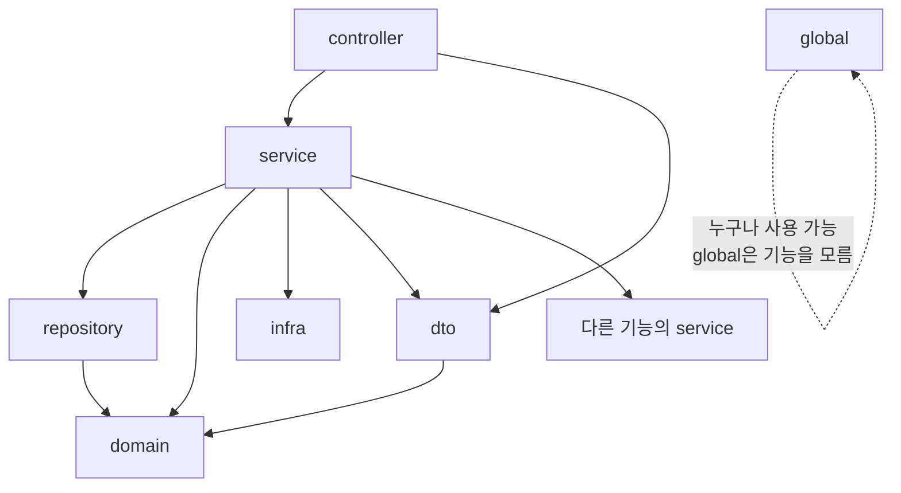

# Layered Architecture 설계 기준 (Spring Boot)

> Spring Boot 백엔드를 **레이어드 아키텍처 베스트 프랙티스**로 만들기 위한 설계 기준 문서다.
> `layered-architecture` 스킬이 뼈대 생성(init)과 기능 추가(feature) 때 이 문서를 읽고 따른다. 사람이 읽을 때는 §17 체크리스트부터 봐도 된다.
> `{base}`는 기본 패키지(예: `com.example.shop`), `{feature}`는 업무 기능 이름(예: `order`), `{Feature}`·`{Entity}`는 그 PascalCase다.

---

## 1. 목적과 우선순위

목적은 **모든 기능이 같은 모양**을 갖게 하는 것이다. 어떤 기능을 열어도 클래스가 같은 자리에 있고, 같은 방식으로 트랜잭션을 걸고, 같은 형식으로 에러를 돌려주면 읽는 사람이 구조를 다시 익힐 필요가 없다.

| 문서 | 역할 | 우선순위 |
|---|---|---|
| 프로젝트 `CLAUDE.md`의 불변 규칙 | 그 프로젝트만의 도메인 규칙(상태 전이 방식, 중복 방지 방식 등) | 1 (가장 높음) |
| `RULES.md` | 어기면 안 되는 아키텍처 규칙 목록 | 2 |
| 이 문서 | 규칙의 상세, 이유, 예시 | 3 |
| `lombok-support` 스킬 | Lombok 적용 범위 | §9에서 참조 |

프로젝트 규칙이 이 문서와 다르면 프로젝트 규칙을 따르고, 다르게 한 이유를 그 프로젝트의 설계 문서에 적는다.

---

## 2. 계층과 책임

```
요청 →  Presentation (controller)     HTTP ↔ DTO 변환, 형식 검증
          ↓
        Application (service)          use case 하나 = 트랜잭션 경계, 업무 규칙
          ↓            ↘
        Persistence    Infrastructure  DB 접근 / 외부 시스템 호출
        (repository)   (infra)
          ↓
        Domain (domain)                Entity, enum, 자기 값으로 판단하는 규칙
```

| 계층 | 패키지 | 하는 일 | 하지 않는 일 |
|---|---|---|---|
| Presentation | `controller` | 요청을 Request DTO로 받고 `@Valid`로 형식을 검증한 뒤 **Service 메서드 하나**를 호출해 Response DTO를 돌려준다 | 업무 판단, Repository 호출, try-catch로 응답 만들기, `@Transactional` |
| Application | `service` | use case를 끝까지 처리한다. **트랜잭션 경계**다. 업무 규칙을 검사하고 Repository·Domain·Infra를 조합한다 | HTTP 개념(`HttpServletRequest`, `ResponseEntity`) 사용, 트랜잭션 안에서 외부 HTTP 호출 |
| Persistence | `repository` | DB 읽기·쓰기. Spring Data JPA 인터페이스와 직접 쓴 쿼리 | 업무 판단, 다른 Repository 호출 |
| Domain | `domain` | 테이블과 매핑되는 Entity, enum, 값 객체. 자기 필드만으로 판단할 수 있는 규칙(`isCancelable()`, 금액 계산) | Service·Repository·DTO·Spring 웹 의존, API 응답으로 노출 |
| (경계 객체) | `dto` | 계층 경계에서 오가는 값. Request, Response, Command | 업무 로직 |
| (기능 예외) | `exception` | 그 기능의 `ErrorCode` enum과 예외 클래스 | |
| Infrastructure | `{base}.infra.{system}` | 외부 시스템(PG, 메일, 외부 API) 호출을 감싸고 외부 응답을 우리 객체로 바꾼다 | 우리 DB 접근, 트랜잭션, 업무 판단 |

> 💡 **"application layer"는 책임의 이름이고 패키지 이름은 `service`다.** 책에서 말하는 application layer가 이 구조의 service 패키지다.
>
> 💡 **Service 위에 Facade·Manager 같은 조율 계층을 만들지 않는다.** 외부 호출 때문에 트랜잭션을 나눠야 하는 경우도 Service 안에서 `TransactionTemplate`으로 해결한다(§7). 계층이 늘면 "어떤 경우에 Facade를 만드나"라는 기준이 하나 더 생기고, 기능마다 모양이 달라진다.

---

## 3. 패키지 구조

**기능(feature) 우선으로 나누고, 그 안을 계층으로 나눈다.**

```
{base}
├─ {feature}                      업무 기능 하나 (예: product, order, payment)
│   ├─ controller                 {Feature}Controller
│   ├─ service                    {Feature}Service
│   ├─ repository                 {Entity}Repository, {Feature}QueryRepository
│   ├─ domain                     {Entity}, enum, 값 객체
│   ├─ dto                        {Feature}{Action}Request, {Feature}Response, {Feature}{Action}Command
│   └─ exception                  {Feature}ErrorCode
├─ global                         업무 규칙이 없는 기술 공통 코드만
│   ├─ config                     JPA Auditing, Clock 등 설정
│   ├─ error                      ErrorCode(인터페이스), BusinessException, GlobalExceptionHandler
│   ├─ entity                     BaseTimeEntity
│   └─ web                        PageResponse 등 웹 공통 (필요할 때만)
└─ infra                          외부 시스템 연동
    └─ {system}                   {System}Client(인터페이스), Http{System}Client, 요청/응답 record, 설정
```

**왜 기능 우선인가.** 계층 우선(`controller/OrderController`, `controller/PaymentController` …)으로 나누면 결제 하나를 고칠 때 폴더 다섯 개를 오간다. 기능 우선이면 `payment` 폴더 하나에 결제 코드가 모이고, 기능 사이 의존이 import에 `order.`, `payment.`로 바로 드러난다. 나중에 기능 하나를 별도 서비스로 떼어 낼 때도 경계가 이미 그어져 있다.

**규칙**
1. 필요 없는 하위 패키지는 만들지 않는다. 외부 연동이 없는 기능은 infra를 쓰지 않고, 기능 예외가 없으면 `exception`이 없어도 된다
2. `global`에는 **업무 규칙이 없는 기술 공통 코드**만 둔다. 하위 패키지는 위 네 개로 제한하고, 새로 필요하면 이 문서에 먼저 추가한다. "나중에 공유할지도 몰라서"는 global에 넣을 이유가 아니다
3. 두 기능이 함께 쓰는 **업무** 코드는 global이 아니라 그 코드의 주인 기능에 두고 다른 기능이 그 Service를 부른다. 주인이 없으면 새 기능 패키지로 만든다(예: 여러 기능이 쓰는 상태 이력 → `history` 기능)
4. `common`, `util`, `helper`, `manager` 같은 이름의 패키지를 만들지 않는다. 기준 없이 무엇이든 들어가는 공간이 된다
5. `api`는 URL 경로(`/api/**`)나 API 계약을 말할 때만 쓰고 **패키지 이름으로 쓰지 않는다**

```
✅ {base}.order.service.OrderService
✅ {base}.global.error.BusinessException
✅ {base}.infra.pg.PgClient
❌ {base}.api.order.OrderController          // api를 패키지명으로
❌ {base}.common.util.OrderUtils             // 업무 규칙이 공통 패키지에
❌ {base}.controller.OrderController         // 계층 우선
❌ {base}.order.facade.OrderFacade           // 문서에 없는 계층
```

---

## 4. 의존 방향



**규칙**
1. 의존은 **위에서 아래로만** 흐른다. service가 controller를, repository가 service를 import하지 않는다
2. **계층을 건너뛰지 않는다.** Controller는 Repository를 주입받지 않는다. 조회만 하는 단순 API도 Service를 거친다. 한 번 예외를 두면 "여기도 단순하니까"가 반복되고 Controller에 업무 판단이 쌓인다
3. Controller는 Domain(Entity)을 직접 다루지 않는다. Response DTO만 받는다
4. `domain`은 controller·service·repository·dto·infra를 import하지 않는다. `global`(BaseTimeEntity, BusinessException)과 자기 기능의 `exception`은 쓸 수 있다
5. **다른 기능의 데이터를 바꿀 때는 그 기능의 Service를 부른다.** 다른 기능의 Repository·Controller를 쓰지 않는다. 다른 기능의 domain 타입(enum, Entity)을 읽기용으로 참조하는 것은 허용한다
6. **기능 사이 순환 의존을 만들지 않는다.** `order → payment → order`가 생기면 뒤로 흐르는 쪽을 이벤트(§6.4)로 바꾼다
7. `global`은 어떤 기능 패키지도 import하지 않는다. `infra`는 기능의 controller·service·repository를 import하지 않는다
8. Entity 사이 연관관계는 **같은 기능 안에서만** 객체로 맺는다. 다른 기능의 Entity는 ID로 참조한다(`private Long productId`). 기능 경계를 넘는 `@ManyToOne`은 지연 로딩과 cascade가 기능 경계를 넘어 퍼지게 만든다

이 규칙은 §16의 `ArchitectureTest`(ArchUnit)가 빌드할 때마다 검사한다.

---

## 5. Controller

```java
@RestController
@RequiredArgsConstructor
@RequestMapping("/api/products")
public class ProductController {

    private final ProductService productService;

    @PostMapping
    public ResponseEntity<ProductResponse> create(@Valid @RequestBody ProductCreateRequest request) {
        ProductResponse response = productService.create(request.toCommand());
        return ResponseEntity.created(URI.create("/api/products/" + response.id())).body(response);
    }

    @GetMapping("/{productId}")
    public ProductResponse get(@PathVariable Long productId) {
        return productService.get(productId);
    }
}
```

**규칙**
1. 메서드 하나는 **Service 메서드 하나**를 부른다. 여러 Service를 조합해야 하면 그 조합 자체가 use case이므로 Service 메서드로 만든다
2. 성공 응답은 **DTO를 그대로** 돌려준다(공통 래퍼 `{ success, data }`를 쓰지 않는다). HTTP 상태 코드가 이미 성공·실패를 말해 준다. 생성은 `201 Created` + `Location`
3. 실패 응답은 Controller가 만들지 않는다. 예외를 던지면 `GlobalExceptionHandler`가 바꾼다(§10)
4. URL은 복수 명사 + 계층형(`/api/orders/{orderId}/payments`). 동사가 필요한 동작은 하위 리소스로 표현한다(`POST /api/orders/{orderId}/cancel`)
5. 인증된 사용자 같은 요청 정보는 Controller에서 꺼내 **값으로** Service에 넘긴다. Service가 `SecurityContextHolder`나 `HttpServletRequest`를 직접 보지 않는다

---

## 6. Service와 트랜잭션

### 6.1 기본

```java
@Service
@RequiredArgsConstructor
public class ProductService {

    private final ProductRepository productRepository;

    @Transactional
    public ProductResponse create(ProductCreateCommand command) {
        if (productRepository.existsByCode(command.code())) {
            throw new BusinessException(ProductErrorCode.DUPLICATE_CODE);
        }
        Product product = productRepository.save(Product.create(command.code(), command.name(), command.price()));
        return ProductResponse.from(product);
    }

    @Transactional(readOnly = true)
    public ProductResponse get(Long productId) {
        return ProductResponse.from(getProduct(productId));
    }

    private Product getProduct(Long productId) {
        return productRepository.findById(productId)
                .orElseThrow(() -> new BusinessException(ProductErrorCode.PRODUCT_NOT_FOUND));
    }
}
```

**규칙**
1. **use case 하나 = public 메서드 하나 = 트랜잭션 하나.** `@Transactional`은 public 메서드에 붙이고 **클래스 전체에 붙이지 않는다.** 메서드만 보고 트랜잭션 여부를 알 수 있어야 한다
2. 조회 메서드는 `@Transactional(readOnly = true)`. 변경 감지를 하지 않아 가볍고, 실수로 쓰는 코드를 막는다
3. Controller, Repository, Infra, Domain에는 `@Transactional`을 붙이지 않는다
4. Service는 **Response DTO를 돌려준다.** Entity를 돌려주면 트랜잭션이 끝난 뒤 Controller에서 지연 로딩 예외가 나거나 Entity가 응답에 섞인다
5. 다른 Service의 public 메서드를 부를 때 트랜잭션은 기본 전파(`REQUIRED`)로 합쳐진다. `REQUIRES_NEW`는 "바깥이 롤백돼도 남아야 하는 기록"처럼 이유를 설명할 수 있을 때만 쓴다

### 6.2 같은 클래스 안에서 부르면 `@Transactional`이 걸리지 않는다

Spring은 `@Transactional`이 붙은 빈 앞에 **프록시**를 세워 트랜잭션을 시작·종료한다. 다른 빈에서 부르면 프록시를 거치지만, 같은 클래스 안에서 `this.method()`로 부르면 프록시를 거치지 않는다. 그래서 그 메서드의 `@Transactional`은 **무시된다.**

```java
public void pay() {
    save();              // ❌ 같은 클래스 호출 → save()의 @Transactional이 적용되지 않음
}
@Transactional
public void save() { ... }
```

이 함정 때문에 "트랜잭션 범위를 메서드 일부로 나누고 싶을 때"는 `@Transactional`이 아니라 §7의 `TransactionTemplate`을 쓴다.

### 6.3 Command

Request DTO는 Controller까지만 쓴다. Service에는 값이 3개 이하면 그대로 넘기고, 더 많으면 `{Feature}{Action}Command` record를 `dto` 패키지에 만들어 넘긴다. Request에 `toCommand()`를 둔다. 이렇게 하면 Service가 HTTP 형식(JSON 필드명, 검증 애노테이션)과 분리되고, 스케줄러나 이벤트에서도 같은 Service 메서드를 부를 수 있다.

### 6.4 이벤트

커밋이 끝난 **뒤에** 다른 기능이 이어서 일해야 할 때(결제 완료 → 발급 시작)는 도메인 이벤트를 쓴다.

```java
// 발행 (payment.service)
eventPublisher.publishEvent(new PaymentCompletedEvent(orderId));

// 구독 (issue.service)
@TransactionalEventListener(phase = TransactionPhase.AFTER_COMMIT)
public void on(PaymentCompletedEvent event) { ... }
```

- 이벤트 record는 **발행하는 기능의 `domain`** 패키지에 둔다(`payment.domain.PaymentCompletedEvent`)
- AFTER_COMMIT 리스너 안에서 DB에 쓰려면 새 트랜잭션이 필요하다(리스너 메서드에 `@Transactional(propagation = REQUIRES_NEW)` 또는 TransactionTemplate)
- 이벤트는 서버가 커밋 직후 죽으면 사라질 수 있다. 반드시 일어나야 하는 후속 작업은 스케줄러 같은 안전망을 함께 둔다

---

## 7. 외부 호출과 트랜잭션 — `TransactionTemplate`

**외부 HTTP 호출은 DB 트랜잭션 안에서 하지 않는다.**

| 트랜잭션 안에서 외부를 호출하면 | 결과 |
|---|---|
| 외부가 느리면 | 응답을 기다리는 동안 DB 커넥션을 잡고 있다. 커넥션 풀이 바닥나 외부 장애가 우리 서비스 전체 장애가 된다 |
| 외부는 성공했는데 우리 쪽이 롤백되면 | "외부에는 결제됐는데 우리 DB에는 흔적이 없는" 상태가 된다 |
| 외부 호출 전에 기록이 커밋되지 않으면 | 장애 후 "무엇을 보냈는지" 추적할 근거가 없다 |

그래서 외부 호출이 있는 use case는 **tx1(보내기 전 기록 커밋) → 외부 호출(트랜잭션 밖) → tx2(결과 저장)** 순서로 나눈다. 나누는 도구는 `TransactionTemplate`이다.

```java
@Service
@RequiredArgsConstructor
public class PaymentService {

    private final PaymentRepository paymentRepository;
    private final PgClient pgClient;
    private final TransactionTemplate transactionTemplate;   // Spring Boot가 자동 등록

    // @Transactional 없음 — 이 메서드는 트랜잭션 범위를 직접 나눈다
    public PaymentResponse pay(PaymentCommand command) {
        // tx1: 보내기 전에 기록하고 커밋
        Payment payment = transactionTemplate.execute(status ->
                paymentRepository.save(Payment.ready(command.orderId(), command.amount())));

        // 외부 호출: 트랜잭션 밖
        PgApproval approval = pgClient.approve(payment.getId(), payment.getAmount());

        // tx2: 결과 저장
        return transactionTemplate.execute(status -> {
            Payment saved = getPayment(payment.getId());
            saved.approve(approval.transactionId());
            return PaymentResponse.from(saved);
        });
    }
}
```

**왜 TransactionTemplate인가**
- 트랜잭션 범위가 **코드 블록으로 눈에 보인다.** `execute(...)` 안이 트랜잭션이고 밖은 아니다
- 프록시를 쓰지 않으므로 §6.2 함정(같은 클래스 호출)이 없다. 트랜잭션 때문에 클래스를 쪼갤 필요가 없다
- use case가 Service 메서드 하나에 그대로 남는다. Facade 같은 계층을 새로 만들지 않아도 된다

**규칙**
1. 외부 호출이 있는 Service 메서드에는 `@Transactional`을 붙이지 않고, DB 작업만 `transactionTemplate.execute()`로 감싼다
2. 외부 호출이 없는 use case는 §6의 선언적 `@Transactional`을 쓴다. **한 메서드에 두 방식을 섞지 않는다**(`@Transactional` 메서드 안에서 `TransactionTemplate`을 쓰지 않는다)
   - tx2가 웹훅·스케줄러 같은 다른 경로와 **공유하는 use case**라면, 직접 감싸지 않고 그 use case를 가진 **다른 Service의 `@Transactional` 메서드**를 불러도 된다. 다른 빈이므로 프록시가 적용된다
3. `TransactionTemplate`은 Spring Boot가 자동 등록한 빈 하나를 주입받아 쓴다. 직접 `TransactionTemplate` 빈을 등록하면 자동 등록이 꺼지므로, 조회 전용 등 다른 설정이 꼭 필요할 때만 설계안에 이유를 적고 추가한다
4. tx2에서는 tx1에서 받은 Entity를 그대로 고치지 않고 **다시 조회**한다. tx1이 끝나 그 객체는 영속성 컨텍스트에서 분리(detached)됐기 때문이다
5. 외부 호출이 실패·타임아웃이면 tx1 기록은 남아 있다. 그 상태를 누가 어떻게 마무리하는지(재조회, 스케줄러, 운영자 조치)를 설계안에 적는다
6. 재시도는 횟수 상한을 둔다. 상한을 넘으면 실패 상태로 두고 운영자가 볼 수 있게 한다

---

## 8. DTO

```java
public record ProductCreateRequest(
        @NotBlank @Size(max = 30) String code,
        @NotBlank @Size(max = 100) String name,
        @PositiveOrZero int price) {

    public ProductCreateCommand toCommand() {
        return new ProductCreateCommand(code, name, price);
    }
}

public record ProductResponse(Long id, String code, String name, int price, Instant createdAt) {
    public static ProductResponse from(Product product) {
        return new ProductResponse(product.getId(), product.getCode(), product.getName(),
                product.getPrice(), product.getCreatedAt());
    }
}
```

**규칙**
1. DTO는 Java **`record`**로 만든다. 불변이고 생성자·equals·toString이 자동이라 Lombok이 필요 없다
2. **Entity를 API 응답으로 돌려주지 않는다.** 내부 필드 노출, 지연 로딩 예외, 순환 참조 직렬화, 테이블 변경이 곧 API 변경이 되는 문제가 생긴다
3. Entity → Response 변환은 **Response의 정적 팩토리 `from(entity)`** 한 곳에서 한다. Entity에 `toResponse()`를 두지 않는다(domain이 dto를 알게 되므로 §4-4 위반)
4. Request → Command 변환은 **Request의 `toCommand()`**에서 한다
5. 요청과 응답 DTO를 같은 클래스로 쓰지 않는다. 한쪽 필드가 바뀌면 다른 쪽 계약이 같이 바뀐다
6. 시각은 `Instant`(UTC, ISO-8601)로 내보낸다. 표시용 시간대 변환은 화면에서 한다
7. 목록에 페이지가 필요하면 Spring의 `Page`를 그대로 직렬화하지 않고 `global.web.PageResponse<T>`로 바꿔 돌려준다(`Page`의 JSON 형식은 버전마다 바뀔 수 있다)

---

## 9. Domain (Entity)

```java
@Entity
@Getter
@NoArgsConstructor(access = AccessLevel.PROTECTED)
public class Product extends BaseTimeEntity {

    @Id @GeneratedValue(strategy = GenerationType.IDENTITY)
    private Long id;

    @Column(nullable = false, unique = true, length = 30)
    private String code;

    @Column(nullable = false, length = 100)
    private String name;

    private int price;

    @Enumerated(EnumType.STRING)
    @Column(nullable = false, length = 20)
    private ProductStatus status;

    public static Product create(String code, String name, int price) {
        Product product = new Product();
        product.code = code;
        product.name = name;
        product.price = price;
        product.status = ProductStatus.ON_SALE;
        return product;
    }

    public void changePrice(int newPrice) {
        if (newPrice < 0) {
            throw new BusinessException(ProductErrorCode.INVALID_PRICE);
        }
        this.price = newPrice;
    }
}
```

**규칙**
1. 기본 생성자는 `protected`. JPA에는 필요하지만 다른 코드가 빈 객체를 만들지 못하게 한다
2. **setter를 만들지 않는다.** 값 변경은 의도가 드러나는 메서드(`changePrice`, `cancel`)로 하고, 그 메서드가 자기 값으로 판단할 수 있는 규칙을 검사한다
3. 생성은 정적 팩토리(`create`)로 한다. 필수값이 빠진 객체가 만들어지지 않는다
4. 연관관계는 `@ManyToOne(fetch = FetchType.LAZY)`. 기본값이 EAGER라서 명시한다. 양방향은 꼭 필요할 때만, 다른 기능 Entity는 ID로 참조한다(§4-8)
5. 목록 조회에서 연관 Entity에 접근하면 N+1 쿼리가 나는지 확인하고 fetch join이나 DTO 조회로 바꾼다
6. enum은 `@Enumerated(EnumType.STRING)`. ORDINAL은 enum 순서가 바뀌면 데이터 의미가 바뀐다
7. 시각은 `Instant`, 돈은 정수(`long`/`int`, 최소 단위)나 `BigDecimal`. `double`은 쓰지 않는다
8. `createdAt`·`updatedAt`은 `global.entity.BaseTimeEntity`를 상속해 JPA Auditing으로 채운다
9. Lombok: `@Getter`와 `@NoArgsConstructor(access = PROTECTED)`만 쓴다. `@Data`, `@Setter`, `@EqualsAndHashCode`, 연관 필드를 포함한 `@ToString`은 쓰지 않는다 → `lombok-support`
10. 스키마는 마이그레이션 도구(Flyway 등)가 만든다. `spring.jpa.hibernate.ddl-auto=validate`로 두고, 이미 적용된 마이그레이션 파일은 고치지 않고 새 버전을 추가한다
11. `spring.jpa.open-in-view=false`로 둔다. 켜 두면 Controller·뷰 렌더링까지 DB 커넥션을 잡고, Service 밖에서 지연 로딩이 "우연히" 동작해 §6.1-4 규칙 위반을 숨긴다
12. 상태 컬럼을 어떻게 바꾸는지(Entity 메서드 / 조건부 UPDATE)에 프로젝트 규칙이 있으면 그것을 따른다(§1)

---

## 10. 예외 처리

### 10.1 구성

```
global.error
├─ ErrorCode                 interface: HttpStatus status(), String code(), String message()
├─ CommonErrorCode           enum: INVALID_REQUEST(400), INTERNAL_ERROR(500) …
├─ BusinessException         RuntimeException + ErrorCode
└─ GlobalExceptionHandler    @RestControllerAdvice, ProblemDetail로 변환

{feature}.exception
└─ {Feature}ErrorCode        enum implements ErrorCode: PRODUCT_NOT_FOUND(404) …
```

**왜 ErrorCode를 인터페이스 + 기능별 enum으로 나누나.** 거대한 enum 하나에 모든 에러를 넣으면 모든 기능이 그 파일을 고치게 되고, 기능 코드가 global에 쌓인다. 기능별 enum이면 에러 코드가 그 기능 폴더 안에 있다.

### 10.2 응답 형식 — `ProblemDetail` (RFC 9457)

Spring 6의 표준 에러 응답 객체 `ProblemDetail`에 `code` 필드를 더해 쓴다.

```json
{
  "type": "about:blank",
  "title": "Not Found",
  "status": 404,
  "detail": "상품을 찾을 수 없습니다.",
  "instance": "/api/products/9",
  "code": "PRODUCT_NOT_FOUND"
}
```

검증 실패(400)는 `errors` 필드에 `[{ "field": "price", "reason": "0 이상이어야 합니다" }]`를 더한다.

**왜 ProblemDetail인가.** 직접 만든 `ErrorResponse`도 되지만, 표준 형식이면 Spring이 기본으로 던지는 예외(잘못된 JSON, 없는 URL, 지원하지 않는 메서드)까지 같은 모양으로 나온다. 클라이언트는 `code`만 보고 분기하면 된다.

### 10.3 규칙
1. Controller와 Service에서 try-catch로 응답을 만들지 않는다. 예외를 던지고 형식은 `GlobalExceptionHandler` 한 곳이 정한다
2. 업무 규칙 위반은 `BusinessException(ErrorCode)`로 던진다. 메시지를 문자열로 흩뿌리지 않는다
3. `GlobalExceptionHandler`는 `ResponseEntityExceptionHandler`를 상속해 Spring 기본 예외도 ProblemDetail로 받는다
4. 처리하지 못한 예외는 500 `INTERNAL_ERROR`로 바꾸고 **스택 트레이스는 로그에만** 남긴다. 예외 메시지를 응답에 넣지 않는다(내부 정보 노출)
5. 외부 연동 예외(타임아웃, 5xx)는 Infra Client에서 우리 예외로 바꾼다. HTTP 클라이언트 라이브러리 예외가 Service까지 올라오지 않게 한다
6. "이미 처리된 요청"처럼 정상 흐름의 한 갈래는 예외로 표현하지 않는다

---

## 11. 검증

| 무엇을 | 어디서 | 어떻게 |
|---|---|---|
| 형식(필수, 길이, 범위, 패턴) | Request DTO | `@NotBlank`, `@Size`, `@Positive` + Controller 파라미터 `@Valid` |
| 업무 규칙(재고가 있나, 이미 취소됐나, 다른 데이터와의 관계) | Service | 위반 시 `BusinessException` |
| 자기 필드만으로 판단되는 규칙 | Domain 메서드 | `product.changePrice()` 안에서 검사 |
| 중복·동시성 | DB | UNIQUE 제약, 조건부 UPDATE. 애플리케이션의 "조회 후 없으면 저장"만으로 막지 않는다 |

- `existsBy…` 같은 사전 검사는 **친절한 에러 메시지용**이다. 동시에 들어온 요청은 DB 제약이 막고, 제약 위반 예외(`DataIntegrityViolationException`)를 같은 `ErrorCode`로 바꾼다
- "오늘", "지금"이 필요한 검증은 주입받은 `Clock`으로 계산한다(§14)

---

## 12. 네이밍

### 12.1 클래스

| 역할 | 이름 | 예 |
|---|---|---|
| Controller | `{Feature}Controller`. 관리자용은 `Admin{Feature}Controller` | `OrderController` |
| Service | `{Feature}Service`. 메서드가 많아지면 행위로 나눔 `{Feature}{Action}Service` | `OrderService`, `OrderCancelService` |
| Repository | `{Entity}Repository`. 여러 테이블 조회 전용은 `{Feature}QueryRepository` | `OrderRepository`, `AdminOrderQueryRepository` |
| Entity | 테이블 이름의 PascalCase(단수) | `order_item` → `OrderItem` |
| Request / Command / Response | `{Feature}{Action}Request`, `{Feature}{Action}Command`, `{Feature}Response`, 목록 요약 `{Feature}SummaryResponse` | `OrderCreateRequest` |
| 기능 에러 코드 | `{Feature}ErrorCode` | `OrderErrorCode` |
| 외부 Client | `{System}Client`(인터페이스) + `Http{System}Client`(구현) | `PgClient`, `HttpPgClient` |
| 이벤트 | `{Entity}{과거분사}Event` | `PaymentCompletedEvent` |
| 스케줄러 | `{동작}Scheduler` | `PaymentExpireScheduler` |

### 12.2 메서드

| 의미 | 이름 | 규칙 |
|---|---|---|
| 하나 조회, 없으면 예외 | `get{X}` | `getOrder(id)` → `{FEATURE}_NOT_FOUND` |
| 하나 조회, 없을 수 있음 | `find{X}` | `Optional` 반환 |
| 목록 | `get{X}s`, 조건 검색 `search{X}s` | 빈 목록은 예외가 아니다 |
| 생성 | `create`, `register` | |
| 상태를 바꾸는 동작 | 업무 동사 | `cancel`, `approve`, `ship`. `update{X}Status` 같은 이름은 쓰지 않는다 |

### 12.3 Repository 쿼리와 DB

- Spring Data 파생 쿼리(`findByCode`)는 조건이 **2개 이하**일 때만. 길어지면 `@Query`로 쓰고 이름은 의미로 짓는다(`findExpiredReadyPayments`)
- 영향 행 수가 중요한 UPDATE·DELETE는 `@Modifying` + 반환형 `int`로 쓰고 호출하는 쪽에서 결과를 확인한다
- 테이블·컬럼은 **snake_case**, 테이블은 단수(`orders`처럼 예약어 충돌 시만 예외). 시각 컬럼은 `{동작}_at`(`paid_at`), 외부 식별자는 출처 접두어(`pg_tid`)
- Entity 필드는 camelCase로 두고 컬럼 매핑은 Spring 기본 네이밍 전략(camelCase → snake_case)에 맡긴다

---

## 13. 외부 연동 (Infrastructure)

```
infra.pg
├─ PgClient              interface — Service가 의존하는 것
├─ HttpPgClient          RestClient 구현 + 외부 요청·응답 형식(중첩 record, 커지면 별도 파일)
├─ PgApproval            Service에 돌려주는 우리 쪽 결과 (record)
├─ PgProperties          @ConfigurationProperties("external.pg")
└─ PgClientConfig        RestClient 빈 (base URL, 타임아웃)
```

**규칙**
1. 외부 HTTP 호출은 `infra.{system}`의 Client에서만 한다. Service 코드에 `RestClient` 호출을 흩뿌리지 않는다
2. Service는 **인터페이스**(`PgClient`)에 의존한다. 테스트에서 가짜 구현으로 바꾸기 쉽고, 외부 업체가 바뀌어도 Service는 그대로다
3. **연결·응답 타임아웃을 반드시 설정한다.** 기본값(무한 대기)이면 외부 장애가 우리 스레드를 모두 잡는다
4. 외부 요청·응답 형식은 infra 안의 전용 record로 둔다. 우리 API DTO를 외부 호출에 재사용하지 않는다
5. Client는 외부 응답을 우리 결과 객체(`PgApproval`)로 바꿔 돌려주고, 외부 예외는 우리 예외로 바꾼다(§10.3-5)
6. Client는 재시도하지 않는다. 재시도 여부와 횟수 상한은 Service·스케줄러가 정한다
7. 외부에서 들어오는 콜백·웹훅은 서명 검증을 먼저 하고, 검증 전에는 본문을 업무 DTO로 바꾸지 않는다

---

## 14. 설정과 시간

1. 설정값은 `@ConfigurationProperties` + record로 묶어 받는다. `@Value`를 여러 곳에 흩뿌리지 않는다
2. **시크릿(비밀번호, API 키, 서명 키)은 환경 변수로만 받는다.** `application.yml`에는 `${PG_SECRET}` 같은 자리표시자만 둔다
3. 현재 시각은 `global.config.ClockConfig`가 등록한 `Clock` 빈을 주입받아 `Instant.now(clock)`으로 얻는다. `LocalDateTime.now()`, `new Date()`를 쓰지 않는다. 테스트에서 시간을 고정할 수 있고 서버 시간대에 따라 결과가 달라지지 않는다
4. 저장은 UTC(`Instant`, DB `timestamptz`)로 하고, 특정 시간대(KST 등)는 표시하거나 "그 시간대의 날짜"를 계산할 때만 쓴다
5. 서버 프로세스 시간대(`TimeZone.setDefault`)에 의존하는 코드를 쓰지 않는다

---

## 15. 로깅과 보안

1. 로거는 `@Slf4j`. `System.out.println`, `printStackTrace()`를 쓰지 않는다
2. **로그에 남기지 않는 것**: 비밀번호, 토큰, API 키, 서명 값, 카드·계좌 정보, 개인 식별 정보. 꼭 필요하면 일부만 남기고 가린다
3. 로그에는 추적용 식별자(`orderId`)와 상태 변화(from → to), 외부 호출 결과 코드를 남긴다
4. Entity를 통째로 로그에 찍지 않는다(`toString`에 민감 필드나 지연 로딩이 섞인다)
5. 에러 레벨: 우리가 예상한 업무 예외는 `WARN`(또는 `INFO`), 예상하지 못한 예외만 `ERROR` + 스택 트레이스
6. 의존성 주입은 **생성자 주입**만 쓴다(`@RequiredArgsConstructor` + `private final`). 필드 주입(`@Autowired` 필드)은 쓰지 않는다

---

## 16. 테스트

| 대상 | 방법 | 검증할 것 |
|---|---|---|
| 아키텍처 | **ArchUnit `ArchitectureTest`** | §4 의존 규칙, §6 트랜잭션 위치, 필드 주입 금지 — 빌드마다 자동 검사 |
| Controller | `@WebMvcTest` + `MockMvc`, Service는 `@MockBean`(Boot 3.4+는 `@MockitoBean`) | 요청 검증 실패 시 400 + `code`, 응답 JSON 필드, 상태 코드, URL |
| Service — 업무 규칙 | 순수 단위 테스트(Mockito) | 규칙 분기, 던지는 `ErrorCode` |
| Service — DB가 관여하는 흐름 | `@SpringBootTest` + Testcontainers(운영과 같은 DB) | **저장된 row 수, 상태 값, 외부 호출 횟수** 같은 관찰 가능한 결과 |
| Repository | `@DataJpaTest` + `@AutoConfigureTestDatabase(replace = NONE)` + Testcontainers + `@Import({JpaAuditingConfig.class, ClockConfig.class})`(슬라이스 테스트는 설정 클래스를 읽지 않아 `createdAt`이 비게 된다) | **직접 쓴 쿼리만**(조건부 UPDATE 영향 행 수 등). `findById` 같은 파생 쿼리는 테스트하지 않는다 |
| Infra Client | MockWebServer 또는 WireMock | 타임아웃·실패 응답이 우리 예외로 바뀌는지 |

**규칙**
1. "예외가 안 났다"가 아니라 **관찰 가능한 결과**(row 수, 상태, 응답 필드)를 검증한다. `assertTrue(true)`, assert 없는 테스트를 쓰지 않는다
2. H2 같은 대체 DB로 통합 테스트하지 않는다. 제약·SQL 방언이 달라 운영에서만 나는 문제를 놓친다
3. 동시성 테스트에는 `@Transactional`을 붙이지 않는다(커밋되지 않아 다른 스레드가 볼 수 없다). 출발선은 `CountDownLatch`로 맞춘다
4. 테스트 이름은 `@DisplayName("중복 코드로 등록하면 DUPLICATE_CODE")`처럼 상황과 결과를 쓴다
5. `ArchitectureTest`가 실패하면 테스트를 고치지 말고 코드를 고친다. 규칙 자체를 바꿔야 하면 이 문서를 먼저 고친다

`ArchitectureTest`가 검사하는 규칙 (`templates/test/ArchitectureTest.java.tmpl`):
- controller → service → repository 계층 접근 규칙, 계층 건너뛰기 금지
- domain이 controller·service·repository·dto·infra에 의존하지 않음
- 다른 기능의 repository 사용 금지
- 기능 사이 순환 의존 금지
- global이 기능 패키지에, infra가 기능의 controller·service·repository에 의존하지 않음
- controller에 `@Transactional` 금지, 클래스 레벨 `@Transactional` 금지
- 필드 주입 금지

---

## 17. 새 기능 체크리스트

**구조**
- [ ] 클래스가 `{feature}.{controller|service|repository|domain|dto|exception}` 중 맞는 곳에 있다 (§3)
- [ ] `global`에 새로 넣은 것이 업무 규칙 없는 기술 코드이고, 정해진 하위 패키지 안에 있다 (§3)
- [ ] Facade·Manager·util 같은 문서에 없는 계층·패키지를 만들지 않았다 (§2, §3)
- [ ] Controller가 Repository·Entity를 다루지 않는다. 다른 기능 데이터는 그 기능 Service로 바꾼다 (§4)
- [ ] 다른 기능 Entity는 ID로 참조한다 (§4-8)
- [ ] 클래스·메서드 이름이 §12 표를 따른다

**흐름**
- [ ] Controller 메서드는 Service 메서드 하나를 부르고 DTO를 돌려준다 (§5)
- [ ] `@Transactional`이 Service public 메서드에만 있고, 조회는 `readOnly = true`다 (§6)
- [ ] 외부 호출이 있으면 `@Transactional` 없이 `TransactionTemplate`으로 tx1 → 호출 → tx2로 나눴고, 실패 시 마무리 주체를 정했다 (§7)
- [ ] 커밋 뒤 후속 작업은 `AFTER_COMMIT` 이벤트 + 안전망으로 처리한다 (§6.4)

**경계·예외·검증**
- [ ] Entity가 응답에 나가지 않고 `{Feature}Response.from(entity)`로 바꾼다. Request는 `toCommand()` (§8)
- [ ] Entity: protected 생성자, setter 없음, 정적 팩토리, LAZY, `EnumType.STRING`, `Instant`, `BaseTimeEntity` (§9)
- [ ] 업무 규칙 위반은 `{Feature}ErrorCode` + `BusinessException`, try-catch로 응답을 만들지 않는다 (§10)
- [ ] 형식 검증은 Request `@Valid`, 중복은 DB 제약 (§11)

**연동·설정·보안**
- [ ] 외부 호출은 `infra.{system}` Client 인터페이스 뒤에 있고 타임아웃이 있다 (§13)
- [ ] 시각은 `Clock` 주입, 시크릿은 환경 변수 (§14)
- [ ] 로그에 민감정보와 Entity 통째 출력이 없다. 생성자 주입만 쓴다 (§15)

**테스트**
- [ ] `ArchitectureTest` 통과 (§16)
- [ ] Controller·Service(·직접 쓴 쿼리) 테스트를 만들었고 관찰 가능한 결과를 검증한다 (§16)
- [ ] 스키마 변경은 새 마이그레이션 버전 파일로 했다 (§9-10)

---

## 18. 예시: `product` 기능 하나 끝까지

```
{base}.product
├─ controller/ProductController.java          POST /api/products, GET /api/products/{id}
├─ service/ProductService.java                create(@Transactional), get(readOnly)
├─ repository/ProductRepository.java          JpaRepository<Product, Long> + existsByCode
├─ domain/Product.java                        Entity (§9 예시)
├─ domain/ProductStatus.java                  ON_SALE, STOPPED
├─ dto/ProductCreateRequest.java              record + @Valid + toCommand() (§8 예시)
├─ dto/ProductCreateCommand.java              record
├─ dto/ProductResponse.java                   record + from(Product)
└─ exception/ProductErrorCode.java            PRODUCT_NOT_FOUND(404), DUPLICATE_CODE(409), INVALID_PRICE(400)

src/main/resources/db/migration/V2__create_product.sql

test/.../product
├─ controller/ProductControllerTest.java      @WebMvcTest: 검증 실패 400 + code, 201 + Location
└─ service/ProductServiceTest.java            Testcontainers: 등록 후 row 1개, 중복 코드면 DUPLICATE_CODE
```

외부 호출이 있는 기능은 §7의 `PaymentService.pay()` 모양을 따른다.
