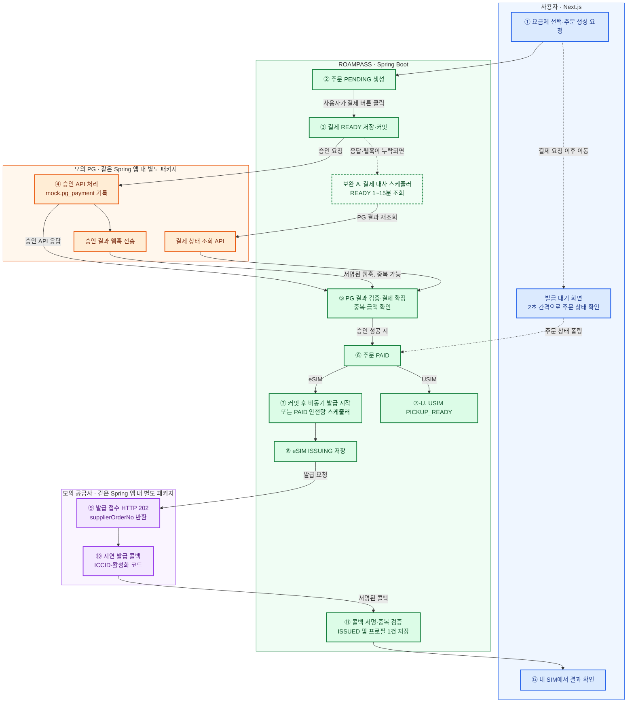
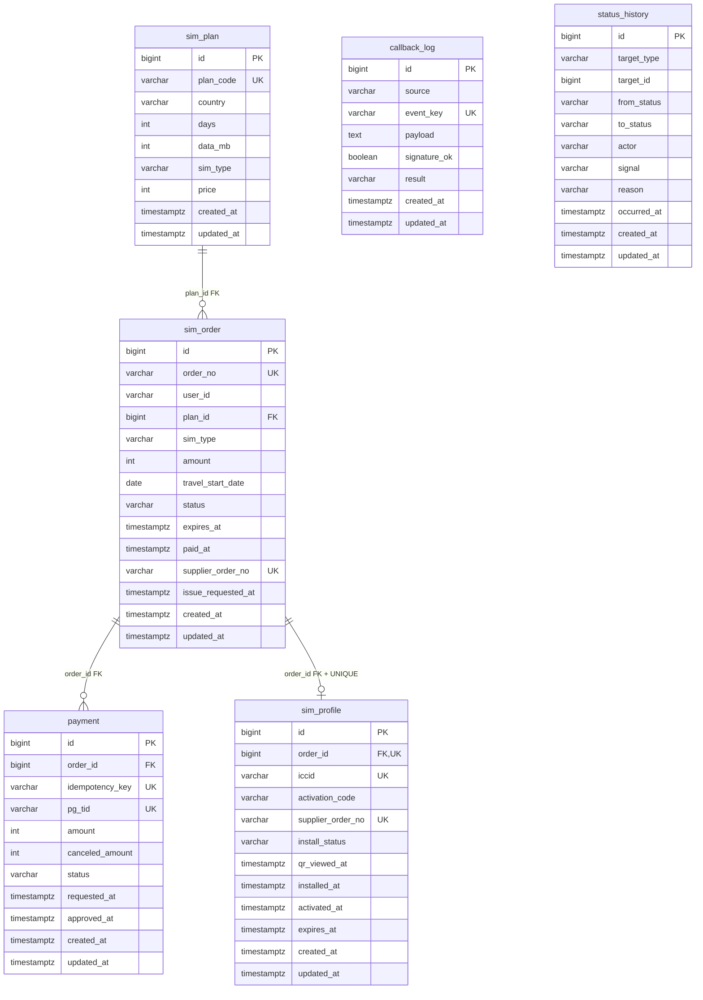
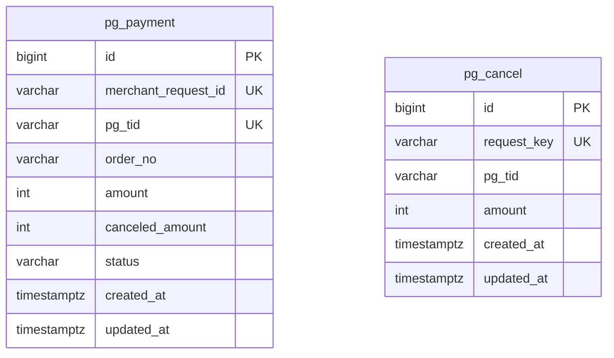
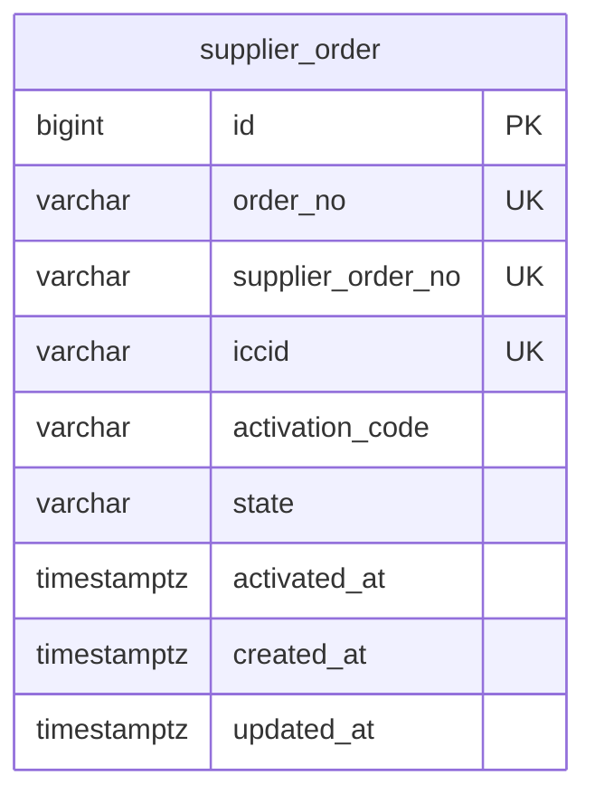
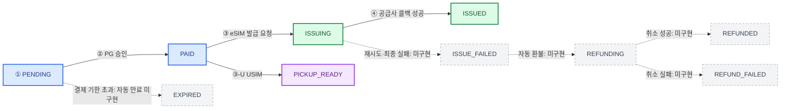

# ROAMPASS

여행자용 eSIM·USIM 요금제를 선택하고 **주문 → 결제 → 발급 → 설치·개통 상태 확인**까지 진행하는 서비스입니다.

## 목차

1. [프로젝트 개요](#1-프로젝트-개요)
2. [기술 스택](#2-기술-스택)
3. [실행할 수 있는 커맨드](#3-실행할-수-있는-커맨드)
4. [접속 가능한 URL 및 배포](#4-접속-가능한-url-및-배포)
5. [과제 질문 8개와 답변](#5-과제-질문-8개와-답변)
6. [미구현·타협한 부분과 이유](#6-미구현타협한-부분과-이유)
7. [시연 방법](#7-시연-방법)
8. [DDL·마이그레이션 스크립트](#8-ddl마이그레이션-스크립트)
9. [테스트 코드](#9-테스트-코드)
10. [실제 투입 시간 및 AI 도구 활용](#10-실제-투입-시간-및-ai-도구-활용)

## 1. 프로젝트 개요

### 1.1 구현 범위

| 영역 | 현재 구현 |
|---|---|
| 사용자 | 요금제 조회, 주문, 결제, 발급 대기, 내 SIM 목록·상세 |
| 결제 | 모의 PG 승인/실패, 웹훅, 중복 처리 방지, 결제 결과 대사 스케줄러 |
| eSIM | 모의 공급사 발급 요청, 서명 검증 콜백, ICCID·활성화 코드 저장 |
| 설치 추적 | 코드 열람 기록, 공급사 상태 조회, 개통·만료 계산 |
| 운영자 | 주문 필터·페이지네이션, 상세 상태 이력, 결제 확정 경로 표시, 데이터 조회 시각 표시 |
| 시연 | `/demo`에서 PG 장애 상황 설정, 공급사 설치·개통 상태 변경, 주문 처리 이력 실시간 조회 |
| 일부 미구현 | 발급 최종 실패 복구·환불, USIM 개통, 운영자 조치 등 → **6장** |

### 1.2 아키텍처와 결제·발급 흐름

**색상 기준 (시스템):** 🔵 Next.js · 🟢 ROAMPASS 서비스 · 🟠 모의 PG · 🟣 모의 공급사. 점선 화살표는 상태 조회·복구 등 보조 경로입니다.



**정상 eSIM 처리 순서**

1. **①~③ 주문·결제 준비:** 요금제를 선택해 `PENDING` 주문을 만들고, 결제 버튼을 누르면 `READY` 결제를 저장합니다.
2. **④~⑥ PG 승인:** 모의 PG가 승인 결과를 응답·웹훅으로 보내면 중복과 금액을 검사하고 주문을 `PAID`로 변경합니다.
3. **⑦~⑨ 발급 요청:** 결제 커밋 후 서버가 발급을 시작해 `ISSUING`으로 바꾸고 모의 공급사에 요청합니다.
4. **⑩~⑫ 발급 완료:** 공급사 콜백을 검증한 뒤 `ISSUED`와 프로필을 저장하고, 사용자는 내 SIM에서 결과를 확인합니다.

**별도 경로:** USIM은 ⑥ 다음에 `PICKUP_READY`로 이동합니다. 결제 승인 응답과 웹훅이 모두 누락되면 **보완 A(결제 대사 스케줄러)** 가 PG 결과를 다시 조회합니다. 발급 대기 화면의 2초 조회는 **화면 갱신용**으로, 발급을 직접 실행하지 않습니다. `/demo`에서는 결제 승인 경로(API 응답·웹훅·대사)를 주문 이력으로 확인할 수 있습니다.

- **모의 PG·공급사:** 실제로는 같은 Spring 앱에서 실행하지만 서로의 API를 **HTTP로 호출**해 웹훅·콜백 흐름을 재현합니다.
- **저장소:** PostgreSQL 16. ROAMPASS 데이터는 `public`, 모의 외부 시스템 데이터는 `mock` 스키마를 사용합니다.
- **현재 복구 범위:** `PAID` 상태의 발급 시작 누락은 스케줄러로 보완하지만, 이미 `ISSUING`에서 멈춘 발급의 최종 실패 처리·환불은 미구현입니다.

### 1.3 데이터 모델 — 세 시스템 분리

**ERD는 저장 주체별로 나눴습니다.** 🟢 ROAMPASS 서비스(`public`) · 🟠 모의 PG(`mock`) · 🟣 모의 공급사(`mock`). 서로 주고받는 주문번호·거래번호는 API 통신용 식별자이며, 별도 시스템 간 외래 키 관계로 표현하지 않았습니다.

**① ROAMPASS 서비스 (`public` 스키마, 6개 테이블)**



- 주문 1건에 **결제 시도 여러 건**이 있을 수 있지만, 승인 결제는 부분 UNIQUE 인덱스로 1건만 허용합니다.
- `sim_profile.order_id UNIQUE`로 **주문당 프로필은 최대 1개**입니다.
- `callback_log`, `status_history`는 대상과 DB 외래 키가 없어서 관계선을 연결하지 않았습니다.

**② 모의 PG (`mock` 스키마, 2개 테이블)**



- 실제 이름은 `mock.pg_payment`, `mock.pg_cancel`입니다. `pg_tid`로 논리적으로 연관되지만 **외래 키 제약은 없습니다**.
- 모의 PG에 취소 API가 존재하는 것과 **ROAMPASS의 환불 처리 기능이 완료된 것**은 다릅니다.

**③ 모의 공급사 (`mock` 스키마, 1개 테이블)**



- 실제 이름은 `mock.supplier_order`입니다. 주문번호로 서비스와 주고받지만 DB 외래 키로 묶지 않았습니다.

### 1.4 주문 상태 전이

**색상 기준 (단계):** 🔵 주문·결제 · 🟢 eSIM 발급 · 🟣 USIM 수령 · ⚪ 회색 점선 미구현. 이 그림은 **업무 상태별**로 색을 구분합니다.



**상태 전이 순서**

1. **① PENDING:** 주문 생성 후 결제 대기.
2. **② PAID:** PG 승인 확인 후 결제 완료.
3. **③ ISSUING → ④ ISSUED:** eSIM 발급 요청 후 공급사 콜백으로 발급 완료.
4. **USIM 예외 경로:** ② 이후 `PICKUP_READY`로 이동합니다. 점선은 자동 처리가 아직 구현되지 않은 전이입니다.

- 실선은 현재 확인된 핵심 흐름, **점선은 상태값이 정의되어 있어도 처리 기능이 미완료인 흐름**입니다.
- 결제 시도는 `READY → APPROVED/FAILED`로 관리합니다. 타임아웃은 즉시 실패로 확정하지 않고 `READY`로 남깁니다.

### 1.5 스케줄러와 누락 복구

**선택 이유:** 외부 PG·공급사 응답은 늦거나 누락될 수 있습니다. 결제·발급은 가능한 한 즉시 처리하고, 결과가 확정되지 않은 건은 **DB에 저장된 상태를 스케줄러가 다시 확인**하도록 구성했습니다. 메시지 큐를 별도로 도입하는 대신 Spring `@Scheduled`를 사용했습니다.

| 스케줄러 | 실행 간격 | 확인 대상 | 처리 내용 |
|---|---|---|---|
| **결제 결과 대사** | 작업 종료 후 60초 | `READY`가 된 지 **1~15분**인 결제 | PG에 실제 결과 조회 → 승인/실패 확정. 조회 자체가 실패하면 다음 주기 재확인 |
| **발급 시작 안전망** | 작업 종료 후 30초 | 결제 후 **30초 이상 `PAID`**인 주문 | 놓친 발급 시작 처리. eSIM은 발급 요청, USIM은 `PICKUP_READY`로 이동 |
| **설치·개통 상태 조회** | 작업 종료 후 60초 | `ISSUED`·`QR_VIEWED`·`INSTALLED` 상태의 SIM | 공급사에 설치·개통 상태 조회, 필요한 경우 `ACTIVE`로 변경. 만료 시각이 지난 `ACTIVE`도 `EXPIRED`로 전환 |

**스케줄러가 필요한 상황**

**색상 기준 (두 가지):** 큰 영역의 배경색은 **업무 종류**(🔵 결제 · 🟢 발급 · 🩵 설치), 각 박스의 색은 **실행 주체**(🟢 ROAMPASS · 🟠 모의 PG · 🟣 모의 공급사)를 뜻합니다. **세 흐름은 순차 실행이 아니라 서로 독립적으로 실행**됩니다.

```mermaid
flowchart TB
  subgraph PAYMENT["결제 대사 · 60초 주기"]
    direction LR
    P1["① READY 상태<br/>1~15분 경과"] --> P2["② 결제 대사<br/>PaymentReconcileScheduler"]
    P2 -->|"HTTP 조회"| P3["③ 모의 PG<br/>결제 결과 조회"]
    P3 -->|"승인 결과"| P4["④ ROAMPASS<br/>APPROVED / FAILED 반영"]
  end

  subgraph ISSUE["발급 시작 안전망 · 30초 주기"]
    direction LR
    I1["① PAID 상태<br/>30초 경과"] --> I2["② 발급 안전망<br/>IssueScheduler"]
    I2 --> I3["③ ROAMPASS<br/>발급 처리 재진입"]
    I3 -->|"eSIM"| I4["④ 모의 공급사<br/>발급 요청"]
    I3 -->|"USIM"| I5["④ ROAMPASS<br/>PICKUP_READY 변경"]
  end

  subgraph INSTALL["설치·개통 및 만료 · 60초 주기"]
    direction LR
    T1["① 개통 전 SIM<br/>ISSUED / QR_VIEWED / INSTALLED"] --> T2["② 설치 폴링<br/>InstallPollingScheduler"]
    T2 -->|"HTTP 조회"| T3["③ 모의 공급사<br/>설치·개통 상태 조회"]
    T3 --> T4["④ ROAMPASS<br/>INSTALLED / ACTIVE 반영"]
    T2 --> T5["⑤ ROAMPASS<br/>만료 지난 ACTIVE → EXPIRED"]
  end

  classDef app fill:#dcfce7,stroke:#15803d,color:#14532d,stroke-width:2px;
  classDef pg fill:#ffedd5,stroke:#ea580c,color:#7c2d12,stroke-width:2px;
  classDef supplier fill:#f3e8ff,stroke:#9333ea,color:#581c87,stroke-width:2px;
  class P1,P2,P4,I1,I2,I3,I5,T1,T2,T4,T5 app;
  class P3 pg;
  class I4,T3 supplier;

  style PAYMENT fill:#eff6ff,stroke:#2563eb,stroke-width:3px
  style ISSUE fill:#f0fdf4,stroke:#16a34a,stroke-width:3px
  style INSTALL fill:#ecfeff,stroke:#0891b2,stroke-width:3px
```



**스케줄러별 실행 순서** *(서로 독립적인 작업이므로 각 경로의 ①부터 읽습니다.)*

1. **결제 대사 (60초 간격):** ① `READY` 1~15분 경과 건 확인 → ② 스케줄러 실행 → ③ PG 결과 조회 → ④ `APPROVED` 또는 `FAILED` 반영.
2. **발급 안전망 (30초 간격):** ① `PAID` 30초 경과 건 확인 → ② 스케줄러 실행 → ③ 발급 처리 재진입 → ④ eSIM이면 공급사에 발급 요청 (USIM은 수령 대기로 변경).
3. **설치 추적 (60초 간격):** ① 개통 전 SIM 확인 → ② 폴링 실행 → ③ 공급사 상태 조회 → ④ `INSTALLED`·`ACTIVE` 반영. 별도로 ⑤ 만료 시각이 지난 `ACTIVE`를 `EXPIRED`로 변경.

- **결제 대사:** PG 조회에서 기록을 찾지 못하면 `FAILED`로 확정합니다. **15분을 초과한 `READY`는 더 이상 자동 조회하지 않으며**, 운영자 이상 건으로 모아 보는 화면은 아직 미구현입니다.
- **발급 안전망:** 결제 커밋 후 `@Async` 이벤트가 정상 실행되면 바로 발급하고, 이벤트가 사라져 **`PAID`에 남았을 때만** 스케줄러가 처리합니다. 두 경로가 동시에 실행되어도 `PAID → ISSUING` 조건부 변경으로 발급 시작을 한 번만 선점합니다.
- **설치 추적:** 사용자가 화면을 닫아도 서버가 공급사 상태를 확인합니다. 현재는 개통 전 SIM을 모두 조회하며, SIM별 조회 주기 최적화는 하지 않았습니다.
- **현재 한계:** `ISSUING` 상태에서 발급 결과가 오지 않으면 이 스케줄러는 복구하지 못합니다. **발급 최종 실패 감지·자동 환불과 주문 `PENDING → EXPIRED` 자동 만료는 미구현**이며, 6장에 분리해 적었습니다.
- **모의 시스템의 지연 전송:** 모의 PG 웹훅과 공급사 발급 콜백은 `TaskScheduler`로 전송 시점을 예약합니다. 위의 **DB 상태 복구용 `@Scheduled` 3개와는 다른 역할**입니다.

**코드 위치**

| 기능 | 파일 |
|---|---|
| 결제 대사 | `backend/src/main/java/com/roampass/payment/service/PaymentReconcileScheduler.java` |
| 발급 안전망 | `backend/src/main/java/com/roampass/issue/service/IssueScheduler.java` |
| 설치 폴링·만료 | `backend/src/main/java/com/roampass/issue/service/InstallPollingScheduler.java` |
| 실행 주기 설정 | `backend/src/main/resources/application.yml` (`app.payment`, `app.issue`, `app.install`) |

## 2. 기술 스택

| 영역 | 사용 기술 | 선택 이유 / 비교한 방식 |
|---|---|---|
| 프론트엔드 | Next.js 15, React 19, TypeScript | Next.js 요구사항. 처음 사용한 만큼 공식 App Router 구조를 기준으로 구성; Pages Router도 고려 |
| 라우터 | App Router | `app/` 폴더와 URL 대응이 명확하고 서버·클라이언트 컴포넌트를 나누기 편함 |
| 데이터 조회 | Server Component `fetch`, TanStack Query | 초기 내용은 서버에서, 발급 대기 중 상태는 2초 폴링. SSE보다 구현 범위가 작음 |
| 백엔드 | Java 17, Spring Boot 3.5, Gradle | 기존에 사용하던 Java·Spring을 활용해 새로운 도메인과 Next.js 학습에 집중 |
| DB 접근 | Spring Data JPA + 조건부 네이티브 SQL | 일반 CRUD는 JPA, 동시성 제어는 `UPDATE ... WHERE status = ...`; MyBatis도 고려 |
| 비동기 작업 | `AFTER_COMMIT` 이벤트, `@Async`, `@Scheduled` | 결제 커밋 후 발급 시작 + 서버 재시작·누락에 대비한 DB 재조회 안전망 |
| HTTP 연동 | Spring `RestClient` | 모의 PG·공급사 호출 및 타임아웃 설정 |
| DB | PostgreSQL 16 | `ON CONFLICT`, 부분 UNIQUE 인덱스 활용 |
| 스키마 관리 | Flyway | V1~V7의 테이블 변경과 시드 데이터 재현 |
| 테스트 | JUnit 5, Testcontainers, ArchUnit | PostgreSQL 동시성 및 패키지 의존 규칙 검증 |
| 로컬 실행 | Docker Compose | Next.js, Spring Boot, PostgreSQL 함께 실행 |

## 3. 실행할 수 있는 커맨드

**필요 환경:** Git, Docker, Docker Compose

```bash
git clone https://github.com/YeBook99/roam_pass.git
cd roam_pass
cp .env.example .env
docker compose up -d --build --wait
```

| 확인 항목 | 주소 / 명령 |
|---|---|
| 사용자 화면 (로컬) | http://localhost:3000 |
| 어드민 화면 (로컬) | http://localhost:3000/admin |
| 시연 설정·실시간 추적 (로컬) | http://localhost:3000/demo |
| **배포 사용자 화면** | **http://15.164.97.63:3000/** |
| 배포 운영자 화면 | http://15.164.97.63:3000/admin |
| 배포 시연 화면 | http://15.164.97.63:3000/demo |
| 백엔드 상태 (로컬) | `curl http://localhost:8080/actuator/health` |
| 컨테이너 확인 | `docker compose ps` |
| 종료 | `docker compose down` |

- 스키마와 기본 요금제 데이터는 **Flyway가 기동 시 적용**합니다.
- JPA는 `ddl-auto: validate`로 스키마 일치 여부만 확인합니다.
- 환경 변수는 `.env.example`을 기반으로 작성하며, **실제 비밀번호·서명 키는 저장소에 포함하지 않습니다.**

## 4. 접속 가능한 URL 및 배포

| 구분 | 주소 |
|---|---|
| **사용자 서비스** | **[http://15.164.97.63:3000/](http://15.164.97.63:3000/)** |
| 운영자 주문 관리 | [http://15.164.97.63:3000/admin](http://15.164.97.63:3000/admin) |
| 모의 PG·공급사 시연 및 주문 추적 | [http://15.164.97.63:3000/demo](http://15.164.97.63:3000/demo) |

- **호스팅:** AWS EC2에 배포했습니다. 현재 도메인 대신 **EC2의 IP 주소와 HTTP 포트 3000**으로 접속합니다.
- **EC2 선택 이유:** 서버에 애플리케이션을 직접 배포하고 실행 환경을 확인할 수 있으며, 과제 시연에 필요한 구성을 단순하게 유지하기 위해 선택했습니다. 관리형 배포 서비스보다 서버 설정을 직접 다뤄야 하는 부담이 있습니다.
- **배포 과정에서 겪은 문제:** EC2에서 Docker 이미지를 빌드할 때 메모리가 부족했습니다. GitHub Actions에서 빌드한 이미지를 GHCR(GitHub Packages)로 전달하는 방식도 검토했지만, 추가 워크플로·레지스트리 설정에 필요한 시간을 고려해 **EC2 인스턴스 사양을 조정**했습니다.
- **보안·접속 방식:** 현재 공개한 주소는 `http://`입니다. HTTPS 또는 별도 도메인 적용 여부는 확인된 배포 정보가 아니므로 적용했다고 표기하지 않았습니다. DB 접속 정보와 웹훅 서명 키의 실제 값은 공개하지 않습니다.

## 5. 과제 질문 8개와 답변

### 5.1 왜 이 기술들을 골랐습니까?

- **Next.js:** App Router를 선택했고, 첫 화면은 Server Component `fetch`, 발급 대기는 TanStack Query 폴링을 사용했습니다. 처음 접하는 Next.js의 구조를 단순하게 유지하려 했습니다.
- **Spring:** 일반 저장·조회는 JPA, 동시 상태 변경은 조건부 SQL, 복잡한 운영자 조회는 JDBC를 사용했습니다. **동시에 같은 요청이 왔을 때 어떤 SQL이 실행되는지** 분명히 보기 위해서입니다.
- **비동기:** 별도 메시지 브로커 대신 커밋 후 이벤트와 스케줄러를 조합했습니다. 빠르게 처리하면서도 `PAID` 상태를 다시 읽어 누락을 보완하기 위해서입니다.
- **DB:** PostgreSQL의 UNIQUE·`ON CONFLICT`·부분 인덱스를 활용했습니다.
- **추가 도구:** Flyway(마이그레이션), Testcontainers(실제 DB 테스트), ArchUnit(구조 규칙 확인)을 사용했습니다.
- **배포:** AWS EC2를 사용했습니다. 직접 서버를 구성할 수 있고 과제 시연에 필요한 배포 방식을 단순하게 유지할 수 있다는 점을 고려했습니다. 실제 배포 주소 및 빌드 중 메모리 문제 해결은 4장에 적었습니다.

### 5.2 결제부터 발급까지 주문 상태를 어떻게 설계했습니까?

- **정상 eSIM:** `PENDING → PAID → ISSUING → ISSUED`
- **정상 USIM:** `PENDING → PAID → PICKUP_READY`
- PG 결과를 모르면 결제는 `READY`로 유지하고, **결제 대사 스케줄러**가 PG에 다시 조회합니다.
- 결제가 완료되면 서버가 비동기 발급을 시작합니다. **브라우저를 닫아도 사용자가 다시 호출할 필요는 없습니다.**
- 이벤트가 유실돼 `PAID`에 남아 있는 주문은 **발급 안전망 스케줄러**가 다시 시작합니다.
- 다만 `ISSUING`에서 계속 멈춘 주문을 실패·환불로 마무리하는 처리는 아직 없습니다(**6장 M1·M2**).

### 5.3 중복 처리를 어떻게 막았고, 어떻게 증명했습니까?

| 문제가 발생하는 과정 | 가능한 중복 문제 | 현재 처리 |
|---|---|---|
| ① **사용자가 결제 버튼 클릭** | 연타·타임아웃 뒤 같은 결제 요청 반복 | 결제 화면에서 만든 UUID `Idempotency-Key`, `payment.idempotency_key UNIQUE`, `INSERT ... ON CONFLICT DO NOTHING` 사용. 동일 키면 기존 결제 재조회 |
| ② **PG 승인 응답과 웹훅 수신** | 동일 승인을 두 경로에서 처리 | 모두 `PaymentConfirmService.confirm()`으로 확정; `READY → APPROVED` 조건부 UPDATE |
| ③ **PG가 웹훅 재전송** | 같은 통지가 여러 번 도착 | `PG:{pgTid}:{status}`를 `callback_log.event_key UNIQUE`로 기록 |
| ④ **공급사가 발급 콜백 재전송** | 한 주문에 프로필 중복 생성 | `SUP:{supplierOrderNo}:ISSUED` UNIQUE + `sim_profile.order_id UNIQUE` |
| ⑤ **외부 웹훅·콜백 수신** | 서명 없는 위조 통지 | 원문 바이트와 공유 키로 `X-Signature` HMAC-SHA256 확인 |
| ⑥ **PG 승인 확정** | 웹훅 금액이 주문 금액과 다름 | 받은 금액을 DB에 저장된 결제 금액과 비교, 불일치 통지로는 승인하지 않음 |

**조건부 UPDATE 예시(설명용):**

```sql
UPDATE payment
SET status = 'APPROVED'
WHERE id = :id AND status = 'READY';
```

변경된 행이 1개면 이번 요청이 처리했고, 0개면 이미 다른 요청이 변경한 것입니다. 단순히 엔티티를 조회한 후 `if → save()`하면 두 요청이 같은 이전 상태를 볼 수 있어 조건부 UPDATE를 선택했습니다.

**검증 범위:** `PaymentWebhookConcurrencyTest`는 실제 HTTP로 웹훅 20개를 보내는 E2E 테스트가 아닙니다. 서비스의 `confirm()`을 21개 스레드에서 동시에 호출하며, 신호만 승인 응답 1건(`API`)·웹훅 20건(`WEBHOOK`)으로 지정합니다. 처리 1회·중복 20회와 DB의 승인·이력·중복 기록을 확인합니다. **HTTP 수신과 HMAC 서명 검증까지 이 테스트가 증명하는 것은 아닙니다.** 공급사 중복 콜백 동시성 테스트도 아직 없습니다.

### 5.4 트랜잭션 경계는 어디에 그었습니까?

| 발생 과정 | DB 트랜잭션 | 외부 호출 |
|---|---|---|
| ① **결제 버튼 클릭** | 결제 `READY` 저장 후 커밋 | 없음 |
| ② **PG 승인 요청** | 열어 두지 않음 | 모의 PG 승인 API 호출 |
| ③ **승인 응답·웹훅·대사 확정** | 결제 상태·주문 상태·이력 변경을 한 트랜잭션에서 저장 | PG 결과를 받은 뒤 반영 |
| ④ **결제 완료 후 발급 시작** | `PAID → ISSUING` 저장 후 커밋 | 없음 |
| ⑤ **공급사 발급 요청** | 열어 두지 않음 | 모의 공급사 발급 API 호출 |
| ⑥ **공급사 콜백 수신** | 주문 `ISSUED`·프로필·이력을 함께 저장 | 콜백 수신 후 검증·반영 |

**이유:** PG·공급사가 늦게 응답하는 동안 DB 트랜잭션을 계속 잡아 두지 않기 위해서입니다.

| 문제가 발생하는 지점 | 현재 대응 |
|---|---|
| **② PG 응답 타임아웃** | 실패로 단정하지 않고 `READY` 유지 → 스케줄러가 1~15분 경과 건을 조회 |
| **③ PG 승인과 웹훅이 동시에 도착** | 공통 확정 로직·조건부 UPDATE로 한 번만 변경 |
| **⑤ 공급사 접수 후 접수번호 저장 실패** | 콜백에 들어오는 우리 `orderNo`로 주문을 다시 찾을 수 있게 처리 |
| **⑤ 발급 요청 후 응답·콜백 모두 누락** | `ISSUING` 복구·실패 보상은 미완료(M1·M2) |
| **① 결제 버튼 연타·재요청** | 화면의 UUID 멱등키 사용; PG 요청 식별자는 내부 `payment.id` 사용 |

### 5.5 사용자가 SIM을 설치했다는 것을 무엇으로 판단합니까?

| 상태 | 판단 근거 |
|---|---|
| `ISSUED` | 프로필 발급 완료. **설치 증거는 아님** |
| `QR_VIEWED` | 사용자가 설치 코드를 열람. **실제 설치 증거는 아님** |
| `INSTALLED` | 공급사 조회 결과가 `INSTALLED` |
| `ACTIVE` | 공급사 상태 `ENABLED`와 개통 시각 `activatedAt` |
| `EXPIRED` | 개통 시각부터 이용 기간 경과 |

- 현재 개통 전 SIM을 **1분마다** 공급사에 조회하고, 사용자도 직접 ‘다시 확인’을 누를 수 있습니다.
- 늦은 신호 때문에 `ACTIVE → INSTALLED`처럼 이전 상태로 돌아가지 않도록 합니다.
- 설치·개통 **이벤트 콜백**과 환불 직전 공급사 최신 상태 확인은 미완료입니다.
- **만료 계산:** 7일을 달력 날짜 7개가 아닌 **7 × 24시간 = 168시간**으로 해석했습니다. 시간대에 따라 실제 사용 시간이 달라지지 않게 하기 위해서입니다. UTC `2026-05-01 15:20Z` 개통이면 KST `2026-05-09 00:20`에 만료됩니다.

### 5.6 사용자·어드민 화면의 서버/클라이언트 경계는 어디입니까?

| 화면 | 서버(Server Component) | 브라우저(Client Component) |
|---|---|---|
| 요금제 | 목록 조회 | 주문 입력 `OrderForm` |
| 결제 | 주문·금액 조회 | `PayButton` |
| 발급 대기 | 최초 주문 상태 | `IssueStatusPoller` (2초마다 재조회) |
| 내 SIM | 주문·프로필·기간 표시 | 설치 코드 열람·상태 재확인 버튼 |
| 어드민 | 필터된 목록·상세 이력 및 결제 확정 경로 조회 | 필터, 새로고침, 조회 시각 표시 |
| 시연(`/demo`) | 현재 PG 장애 설정 조회 | PG 시나리오·세부 설정, 공급사 설치·개통 변경, 주문 이력 2초 조회 |

- 발급 대기는 **완료 시 조회 중단**, 지연되면 안내하고 **5분 후 화면의 자동 조회만 중단**합니다. 서버 발급은 계속 진행됩니다.
- 어드민은 `fetchedAt`을 기준으로 **‘N초 전 데이터’**를 보여 주고, 10초 자동 새로고침을 선택할 수 있습니다. 주문 상세 상단에는 결제를 **승인 API 응답·PG 웹훅·대사 스케줄러 중 어떤 경로로 확정했는지**도 표시합니다.
- 결제·발급 상태는 최신 조회가 중요해 `cache: 'no-store'`를 사용합니다.
- `fetchedAt`은 **어드민 목록을 조회한 시각**이지 공급사가 마지막으로 설치 상태를 확인한 시각은 아닙니다.

### 5.7 이번 과제에서 처음 써본 것은 무엇입니까?

| 처음 사용한 기술·방식 | 이번에 이해한 내용 | 적용 위치 |
|---|---|---|
| **Next.js App Router** | React와 달리 폴더로 경로를 만들고 `'use client'`로 서버·클라이언트 부분을 구분 | `frontend/app`, `frontend/features` |
| **Flyway** | 초기 테이블·기준 데이터와 이후 변경 사항을 **버전별 SQL**로 관리 | `backend/src/main/resources/db/migration` |
| **Claude 하네스 기반 개발 방식** | 요구사항과 규칙을 먼저 정리하고 기능별 구현·검토를 단계적으로 진행 | 프로젝트 문서·구현 과정 |

**학습 방식:** 시간 제약 때문에 먼저 필요한 기능이 구현되는 과정을 따라가고, 낯선 기술·코드가 나오면 AI에 **개념, 사용하는 이유, 사용 방법, 주로 사용하는 상황**을 질문했습니다. 설명을 확인한 뒤 실제 코드를 따라가며 언제 실행되고 어떤 역할을 하는지 파악했습니다.

**AI와 논의했지만 채택하지 않은 방식:** EC2에서 Docker 이미지 빌드 중 메모리가 부족했을 때 GitHub Actions에서 이미지를 빌드하고 **GHCR(GitHub Packages)** 에 올린 뒤 EC2에서 내려받는 방법을 검토했습니다. 하지만 워크플로와 레지스트리 설정을 추가할 시간이 부족해 **EC2 인스턴스 사양 조정**을 선택했습니다. 이는 AI 코드의 오류를 고친 사례가 아니라 **대안을 비교한 사례**입니다.

### 5.8 8시간이 더 있었다면 무엇을 하겠습니까?

| 순위 | 추가 작업 | 이유 |
|---|---|---|
| 1 | `ISSUING` 재시도·최종 실패 감지 | 돈을 받았는데 SIM이 발급되지 않은 주문을 방치하지 않기 위해 |
| 2 | 자동 환불·재시도 및 운영자 이상 건 확인 | 발급 실패 후 고객 결제가 남는 문제를 처리하기 위해 |
| 3 | 공급사 중복 콜백·발급 실패 테스트 | 핵심 정합성을 테스트 결과로 증명하기 위해 |
| 4 | USIM ICCID 등록·개통 | eSIM 외 남은 구매 흐름을 완성하기 위해 |

## 6. 미구현·타협한 부분과 이유

**기본 방향:** 시간 제약으로 결제·eSIM 발급·상태 조회의 주요 흐름부터 구현했습니다. 아래 계획은 **아직 동작하는 기능이 아닙니다.**

| 우선 | 미구현·타협한 부분 | 이유 및 현재 문제 | 보완하려던 방법 |
|---|---|---|---|
| 최상 | **M1. 발급 재시도·최종 실패** | `PAID` 복구는 가능하지만 `ISSUING`에서 멈춘 주문은 복구하지 못함. **발급도 환불도 안 된 주문이 남을 수 있음** | 접수 결과 재조회 → 동일 주문번호로 제한 횟수 재요청 → `ISSUE_FAILED`로 종료·환불 연결 |
| 최상 | **M2. 자동 환불·재시도** | 모의 PG 취소 API만 있고 서비스 환불 워커가 없음 | 환불 요청 기록·멱등키 → 취소 조회/재시도 최대 3회 → 성공 또는 운영자 확인 상태 |
| 최상 | **M3. 필수 테스트 일부** | PG 동시성은 작성했지만 공급사 중복 콜백 동시성·발급 실패 보상 테스트 미작성 | Testcontainers에서 콜백 N건 → 프로필 1개, 발급 실패 → 환불/이상 건 검증 |
| 높음 | M4. 어드민 이상 건 조회 | 일반 목록·상세만 있고 결제 결과 미확인·발급 지연을 모아 보는 화면 없음 | `READY` 15분 초과, 장기 `ISSUING`, 환불 실패 등 분류 |
| 높음 | M5. 운영자 수동 환불·발급 재시도 | 조치 API·사유 이력·동시 조치 방지 미구현 | `X-Admin-Id`·사유·요청 키, 상태 조건부 변경, 조치 이력 |
| 높음 | M6. 모의 공급사 발급 장애 시연 | 공급사 설치·개통 상태 변경 UI는 있지만, **발급 실패·콜백 지연·누락·중복·순서 변경 설정은 없음** | 발급 오류·콜백 장애 설정 API 및 시연 버튼 추가 |
| 중간 | M7. USIM ICCID 입력·개통 | `PICKUP_READY`까지만 구현 | ICCID 자릿수·Luhn·중복 확인 → 공급사 개통 요청 |
| 중간 | M8. 주문 자동 만료 | 결제 기한 저장·결제 가능 시각 검사는 있으나 자동 `EXPIRED` 전환 없음 | 만료 스케줄러 + 늦은 승인과 충돌 시 보상 처리 |
| 중간 | M9. 환불 직전 설치 확인 | 환불 기능과 함께 미구현 | 공급사 최신 상태 조회 후 설치·개통된 SIM 취소 거절 |
| 중간 | M10. 설치·개통 이벤트 콜백 | 발급 콜백만 있고 설치 추적은 폴링 | 서명·중복 확인한 설치 콜백 추가, 폴링은 누락 대비 |
| 후순위 | M11. 설치 조회 최적화·삭제 상태 | 개통 전 SIM 전부 1분 주기 조회 | SIM별 조회 주기·실패 횟수 관리, `DELETED` 처리 |
| 후순위 | M12. 타임라인 추가 정보 통합 | **주문·결제·SIM 상태 이력 조회와 실시간 추적 UI는 구현됨.** 다만 원본 `callback_log`, 환불·운영자 조치 기록은 타임라인에 없음 | 수신 콜백, 환불 시도, 운영자 조치까지 병합 |
| 후순위 | M13. 동일 멱등키 동시 요청의 응답 검증 | `ON CONFLICT DO NOTHING`으로 과거 동일 키 409 충돌 경로를 보완함. 다만 각 요청이 관찰한 상태(`READY`/`APPROVED`)가 같다는 보장은 별도 검증 필요 | 동시 재요청 시 PG 호출 수·최종 결제 건수·응답 상태를 함께 검증하고 필요하면 결과 대기 방식 검토 |
| 후순위 | M14. 사용자 화면 보완 | **환불 버튼·실제 QR 이미지가 없음.** PG 설정 화면은 `/demo`에 구현됨 | 환불 API 연결, 활성화 코드의 QR 이미지화 |

## 7. 시연 방법

**정상 사용:** `/` → 사용자 ID 입력·요금제 선택 → 주문 → 결제 → 발급 대기 → 내 SIM 상세.

**시연 화면:** 배포 주소의 [`/demo`](http://15.164.97.63:3000/demo) 또는 로컬 `/demo`에서 결제 상황을 고르고 주문·결제를 실행한 뒤, 하단 **주문 처리 과정 실시간 보기**에서 결제를 누가 확정했는지 확인할 수 있습니다. 같은 화면에서 공급사 SIM 상태도 바꿀 수 있습니다. 시연 설정은 모든 사용자에게 적용되므로 끝나면 **정상으로 되돌리기**를 누릅니다.

| 시나리오 | 시연 방식 |
|---|---|
| PG 승인 거절 | `PUT /mock/pg/config` → `{"failApprove":true}` |
| PG 응답 지연·타임아웃 | `{"responseDelayMs":4000}` (우리 서버 응답 제한 3초) |
| PG 웹훅 누락만 | `{"webhookCount":0}` → **정상 승인 API 응답**으로 결제 확정 |
| 응답 타임아웃 + 웹훅 누락 | `{"responseDelayMs":4000,"webhookCount":0}` → `READY` 상태를 대사 스케줄러가 PG에 조회해 확정 |
| PG 웹훅 중복 | `{"webhookCount":3}` → 중복 처리 방지 확인 |
| PG 웹훅 금액 변경 | `{"webhookAmountDelta":1000}` |
| PG 설정 초기화 | `POST /mock/reset` |
| 공급사 설치 | `POST /mock/supplier/profiles/{iccid}/state` → `{"state":"INSTALLED"}` |
| 공급사 개통 | 같은 API → `{"state":"ENABLED"}` |

```bash
# 예: 승인 응답을 4초 늦추고 웹훅을 보내지 않음
curl -X PUT http://localhost:8080/mock/pg/config \
  -H 'Content-Type: application/json' \
  -d '{"responseDelayMs":4000,"webhookCount":0}'

# 시연 뒤 초기화
curl -X POST http://localhost:8080/mock/reset

# 발급 후 내 SIM 상세에서 ICCID를 확인해 입력
curl -X POST 'http://localhost:8080/mock/supplier/profiles/<ICCID>/state' \
  -H 'Content-Type: application/json' \
  -d '{"state":"ENABLED","activatedAt":"2026-05-01T15:20:00Z"}'
```

**웹훅 금액 검증:** 금액이 틀린 웹훅은 승인에 사용하지 않습니다. 다만 **정상 PG 승인 응답이나 이후 PG 재조회**로 결제가 승인될 수 있으므로, 결과와 웹훅 검증 여부를 구분해서 확인합니다.

**날짜 입력 주의:** `activatedAt`을 2026-05-01로 넣는 아래 명령은 **만료 계산 예시**입니다. 현재 시각으로 개통을 시연하려면 `activatedAt` 필드를 생략하세요.

## 8. DDL·마이그레이션 스크립트

| 파일 | 생성·변경 내용 |
|---|---|
| [`V1__order_payment.sql`](backend/src/main/resources/db/migration/V1__order_payment.sql) | 요금제·주문·결제·콜백 로그·상태 이력, UNIQUE·부분 인덱스 |
| [`V2__seed_plans.sql`](backend/src/main/resources/db/migration/V2__seed_plans.sql) | eSIM·USIM 요금제 8개 기준 데이터 |
| [`V3__mock_pg.sql`](backend/src/main/resources/db/migration/V3__mock_pg.sql) | `mock.pg_payment`, `mock.pg_cancel` |
| [`V4__issue_request.sql`](backend/src/main/resources/db/migration/V4__issue_request.sql) | 주문의 공급사 접수번호·요청 시각 |
| [`V5__mock_supplier.sql`](backend/src/main/resources/db/migration/V5__mock_supplier.sql) | `mock.supplier_order` |
| [`V6__sim_profile.sql`](backend/src/main/resources/db/migration/V6__sim_profile.sql) | eSIM 발급 프로필 테이블 |
| [`V7__install_tracking.sql`](backend/src/main/resources/db/migration/V7__install_tracking.sql) | QR 열람·설치·개통·만료 시각, 공급사 상태 |

`docker compose up -d --build --wait` 실행 시 Flyway가 빈 PostgreSQL에 순서대로 적용합니다.

## 9. 테스트 코드

| 테스트 파일 | 검증 내용 | 상태 |
|---|---|---|
| [`PaymentWebhookConcurrencyTest.java`](backend/src/test/java/com/roampass/payment/service/PaymentWebhookConcurrencyTest.java) | `confirm()` 21개 스레드 동시 호출(API 신호 1·WEBHOOK 신호 20), 처리·DB 중복 방지 검증. HTTP·HMAC E2E는 검증 대상 아님 | CI 성공 |
| [`ExpiryCalculatorTest.java`](backend/src/test/java/com/roampass/issue/domain/ExpiryCalculatorTest.java) | UTC 개통 시각 + 이용 시간 → KST 만료 시각 | CI 성공 |
| [`ArchitectureTest.java`](backend/src/test/java/com/roampass/ArchitectureTest.java) | 패키지 의존·레이어드 구조 규칙 | CI 성공 |
| 공급사 콜백 동시성 테스트 | 같은 발급 콜백 N건이 와도 프로필 1개 | 미작성 |
| 발급 실패 보상 테스트 | 발급 최종 실패 후 환불·이상 건 추적 | 미작성 |

```bash
# 백엔드 전체 테스트
cd backend
./gradlew test

# 결제 웹훅 동시성만
./gradlew test --tests '*PaymentWebhookConcurrencyTest' --info

# 프론트 확인
cd ../frontend
npm ci
npm run lint
npm run build
```

**검증 결과:** `develop` 커밋 `d8225814`의 [GitHub Actions CI](https://github.com/YeBook99/roam_pass/actions/runs/39793085896)에서 백엔드 `./gradlew test`와 프론트 `npm ci`·lint·build가 성공했습니다. README 편집용 환경에서 별도 재실행한 결과는 아니며, HTTP 수준의 PG·공급사 콜백 E2E 테스트가 추가된 것은 아닙니다.

## 10. 실제 투입 시간 및 AI 도구 활용

- **실제 투입 시간:** 약 12시간
- **사용 도구:** Claude CLI
- **사용 범위:** 요구사항 정리, 구현 진행, 낯선 코드·개념 이해, 설계 대안 비교, 테스트 및 문서 검토
- **본인이 확인한 방식:** 사용된 기능의 개념·사용 이유·사용 방법을 질문하고, 실제 호출 순서와 파일 위치를 따라가며 코드 흐름을 확인했습니다.
- **AI와 검토 후 제외한 방법:** EC2 메모리 부족에 대해 GitHub Actions + GHCR 이미지 빌드·전달 구성을 고려했으나, 추가 설정 공수를 줄이기 위해 EC2 사양 조정을 선택했습니다(5.7 참조).
