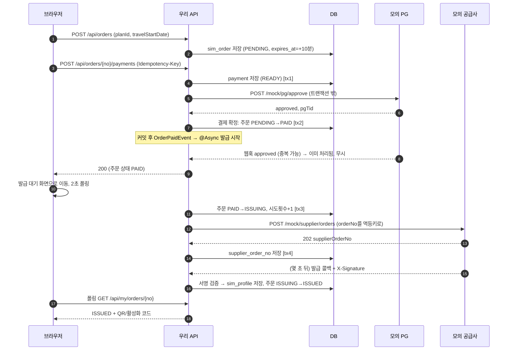

# 01. 아키텍처 개요

## 1. 전체 구조 한눈에 보기

```mermaid
flowchart LR
    subgraph Browser["브라우저"]
        U[사용자 화면]
        A[어드민 화면]
    end

    subgraph Next["Next.js 15 (App Router)"]
        SC[Server Component<br/>초기 데이터 조회]
        CC[Client Component<br/>버튼·폴링]
    end

    subgraph Spring["Spring Boot 앱 (하나의 프로세스)"]
        API[우리 서비스 API<br/>/api/**]
        SCH[스케줄러<br/>@Scheduled]
        ASY[비동기 작업<br/>@Async]
        subgraph Mock["모의 외부 시스템 (별도 패키지)"]
            PG[모의 PG<br/>/mock/pg/**]
            SUP[모의 공급사<br/>/mock/supplier/**]
        end
    end

    DB[(PostgreSQL<br/>public 스키마 + mock 스키마)]

    U --> SC & CC
    A --> SC & CC
    SC -- "서버에서 직접 호출" --> API
    CC -- "/api/* (Next rewrites)" --> API
    API -- "실제 HTTP" --> PG
    API -- "실제 HTTP" --> SUP
    PG -- "웹훅 (HTTP)" --> API
    SUP -- "콜백 + X-Signature (HTTP)" --> API
    SCH --> API
    API --> DB
    PG & SUP --> DB
```

### 핵심 포인트
- **모의 PG와 공급사는 같은 Spring 앱 안에 있지만, 우리 코드는 이들을 진짜 외부 서버처럼 HTTP로만 호출한다.** 자바 메서드를 직접 부르면 타임아웃, 중복 콜백, 순서 뒤바뀜 같은 "네트워크 너머의 문제"를 재현할 수 없기 때문이다
- 모의 시스템의 데이터는 `mock` 스키마에 따로 둔다. 원래는 남의 서버이므로 우리 테이블과 섞지 않는다
- 서버가 하나라서 무료 배포가 쉽다. 대신 "실제로는 공급사 장애가 우리 서버 장애와 무관해야 한다"는 점은 재현되지 않는다(한계)

## 2. 백엔드 패키지 구조 (계획)

```
com.roampass
├─ plan        요금제 조회
├─ order       주문 생성·조회, 만료 스케줄러
├─ payment     결제 요청, PG 웹훅, 대사(PG 상태 조회) 스케줄러, 환불(RefundService)
├─ issue       eSIM 발급 요청·콜백, 발급 재시도 스케줄러, USIM ICCID 등록
├─ install     설치 상태 추적, 상태 조회 폴링 스케줄러, 만료 계산
├─ admin       어드민 목록/상세/이상 건/조치
├─ common
│   ├─ status     StatusTransitionService, status_history
│   ├─ callback   callback_log, HMAC 서명 검증
│   └─ time       Clock 주입(테스트에서 시간 고정), KST 변환
└─ mock
    ├─ pg         모의 PG (승인/취소/조회/웹훅 발송, 설정)
    └─ supplier   모의 공급사 (발급/콜백/개통/프로필 조회, 시연용 상태 변경)
```

계층은 `Controller → Service → Repository`의 평범한 3계층이다. 헥사고날 같은 아키텍처 스타일은 쓰지 않았다. 과제 규모에 비해 파일 수가 늘고, 내가 인터뷰에서 설명할 수 있는 수준을 넘는다고 판단했다(ADR-08).

## 3. 대표 흐름: 이심 구매 (정상 경로)



**브라우저를 3번 직후에 닫아도** 8번 이후는 모두 서버가 혼자 진행한다. 8번의 이벤트가 유실되면(서버 재시작 등) 스케줄러가 `PAID` 상태로 남은 주문을 다시 집어 간다(`04_상태설계.md` §5).

## 4. 실패 경로 요약

| 상황 | 누가 처리 | 결과 |
|---|---|---|
| PG 승인 응답 타임아웃 | 웹훅 또는 대사 스케줄러 | PG 상태 조회로 확정 |
| 결제 10분 미완료 | 만료 스케줄러 | EXPIRED (늦은 승인은 자동 취소) |
| 공급사 접수 실패/콜백 없음 | 발급 재시도 스케줄러 | 최대 3회 → ISSUE_FAILED → 자동 환불 |
| 자동 환불(PG 취소) 실패 | 환불 재시도 스케줄러 | 최대 3회 → REFUND_FAILED → 어드민 이상 건 |
| 서명 틀린 콜백 | 콜백 컨트롤러 | 401 + callback_log 기록 |
| 설치 콜백 누락 | 설치 폴링 스케줄러 | 공급사 상태 조회로 보정 |

## 5. 시연 방법 (README "시연 방법"의 원본)

모의 PG와 공급사의 동작은 **설정값**으로 바꾼다. `PUT /mock/pg/config`, `PUT /mock/supplier/config`에 바꿀 값만 보내고, `POST /mock/reset`으로 기본값에 되돌린다. 요청마다 쿼리 파라미터로 바꾸는 방식은 만들지 않았다. 과제는 "쿼리 파라미터나 설정값"이라고 했고, 설정값 하나로 모든 경우를 재현할 수 있어서다.

| 시연하고 싶은 것 | 방법 (`PUT /mock/pg/config` 본문) |
|---|---|
| 결제 실패 | `{"failApprove": true}` |
| 웹훅 지연 | `{"webhookDelayMs": 5000}` |
| 웹훅 중복 | `{"webhookCount": 3}` |
| 웹훅 누락 | `{"webhookCount": 0}` |
| 승인됐는데 응답 타임아웃 | `{"responseDelayMs": 4000}` (우리 쪽 타임아웃 3초) → READY → 1분 뒤 대사로 확정 |
| 웹훅 금액 조작 | `{"webhookAmountDelta": -1000}` |
| 발급 실패 | supplier config `issueFailRate=1.0` |
| 발급 콜백 지연·중복·누락·순서 뒤바뀜 | supplier config `callbackDelayMs`, `callbackDuplicates`, `callbackDropRate`, `shuffleOrder=true` |
| 서명 위조 콜백 | `POST /mock/supplier/debug/forged-callback` |
| PG 취소 실패 | pg config `{"cancelFailRate": 1.0}` (5xx) |
| 설치·개통 흉내 | `POST /mock/supplier/profiles/{iccid}/state` `{ "state": "INSTALLED" | "ENABLED" | "DELETED", "sendCallback": true/false }` |
| 콜백 누락된 설치 | 위 요청에서 `sendCallback=false` → 폴링으로 반영되는 것 확인 |

> 시연용 엔드포인트는 `mock.enabled=true`일 때만 켜진다. 실제 서비스라면 존재하면 안 되는 API이므로 운영 프로필에서는 끈다는 전제다.

## 6. 인증 (평가 대상 아님)

- 사용자: `X-User-Id` 헤더. 첫 화면에서 아이디를 입력하면 쿠키에 저장하고, 모든 요청에 헤더로 붙인다
- 운영자: `X-Admin-Id` 헤더. `/admin` 화면에서 운영자 아이디를 입력한다
- 모든 `/api/my/**` 조회는 `user_id = X-User-Id` 조건을 건다. 다른 사람 주문을 볼 수 없게 하는 최소한의 방어다

## 7. 한계 (인터뷰에서 먼저 말할 것)

- 앱이 하나라서 모의 공급사 장애와 우리 서버 장애가 분리되지 않는다
- 스케줄러는 **서버 1대**를 가정한다. 2대 이상이면 같은 작업을 동시에 집을 수 있다. 다만 조건부 UPDATE로 상태를 선점하므로 결과가 중복되지는 않고, 불필요한 HTTP 호출이 중복될 뿐이다. 근본 해결은 ShedLock이다
- 인증이 헤더라서 누구나 남의 아이디로 조회할 수 있다(과제 명시사항이라 범위 밖)
