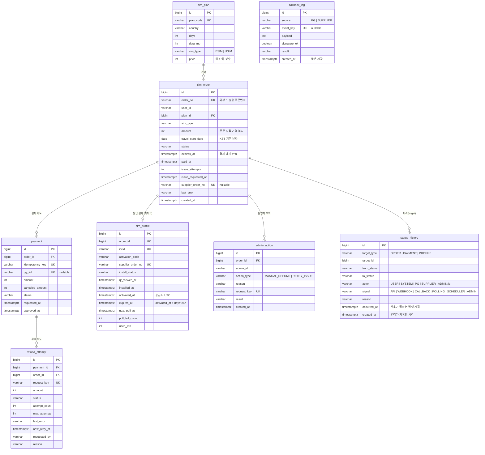

# 03. 데이터 모델

> 원칙: **중복과 꼬임은 애플리케이션 코드가 아니라 DB 제약이 막는다.**
> 코드는 버그가 날 수 있고 서버는 여러 대가 될 수 있지만, DB의 UNIQUE 제약은 누가 어떤 순서로 와도 한 번만 허용한다.
> 그래서 이 문서에서는 **각 UNIQUE 제약이 "무엇을 막으려고" 있는지**를 하나하나 적는다.

## 1. ERD

## 2. 제약 조건과 "무엇을 막는가"

| 테이블.제약 | 막는 사고 |
|---|---|
| `sim_order.order_no UNIQUE` | 외부(PG·공급사)와 주고받는 주문번호가 겹치는 것 |
| `payment.idempotency_key UNIQUE` | **결제 버튼 연타·네트워크 재시도**로 결제 요청이 두 번 만들어지는 것 |
| `payment.pg_tid UNIQUE` | 같은 PG 거래가 두 결제 행에 붙는 것 |
| `payment` 부분 유니크 `(order_id) WHERE status IN ('APPROVED','PARTIAL_CANCELED','CANCELED')` | **한 주문에 승인된 결제가 2건**이 되는 것. 실패한 시도는 여러 번 있어도 됨 |
| `payment` 부분 유니크 `(order_id) WHERE status = 'READY'` | 한 주문에 **결과를 모르는 결제 요청이 동시에 두 개** 나가는 것 (다른 탭에서 동시 결제) |
| `sim_profile.order_id UNIQUE` | **한 주문에 프로필이 두 번 붙는 것** (중복 콜백) |
| `sim_profile.iccid UNIQUE` | 같은 SIM 카드가 두 주문에 등록되는 것 (USIM ICCID 재사용) |
| `sim_profile.supplier_order_no UNIQUE` / `sim_order.supplier_order_no UNIQUE` | 공급사 주문 하나가 여러 주문에 매칭되는 것 |
| `callback_log.event_key UNIQUE` | **같은 웹훅·콜백을 두 번 처리**하는 것 |
| `refund_attempt.request_key UNIQUE` | 운영자 더블클릭으로 환불 요청이 두 번 생기는 것 |
| `refund_attempt` 부분 유니크 `(payment_id) WHERE status IN ('PENDING','IN_PROGRESS')` | 한 결제에 진행 중인 환불이 두 개 생기는 것 |
| `admin_action.request_key UNIQUE` | 같은 클릭이 두 번 기록되는 것 |

> **부분 유니크 인덱스**: 조건(`WHERE`)을 만족하는 행끼리만 중복을 막는 인덱스. "실패한 결제는 여러 번 있어도 되지만 성공한 결제는 하나만"처럼 상태에 따라 규칙이 다를 때 쓴다. PostgreSQL이 지원한다(MySQL은 지원하지 않음 → ADR-06).

## 3. 설계하면서 고민한 점

### 3.1 주문 금액을 요금제에서 복사해 두는 이유
`sim_order.amount`는 주문 시점의 `sim_plan.price`를 **복사**한다. 나중에 요금제 가격이 바뀌어도 이미 만든 주문의 결제 금액 검증("통지 금액 ≠ 주문 금액이면 거절")은 주문 당시 금액을 기준으로 해야 하기 때문이다.

### 3.2 금액을 정수(원)로 저장하는 이유
`double`이나 `float`은 0.1 + 0.2 ≠ 0.3 같은 오차가 있다. 원화는 소수점이 없으므로 `int`(또는 `bigint`)로 저장한다. 다통화(가산점)를 한다면 `BigDecimal`과 `currency` 컬럼을 추가한다.

### 3.3 시각은 전부 `timestamptz`, 날짜 하나만 `date`
- `timestamptz`: 실제로 일어난 "순간"이다. UTC로 저장되고, Java에서는 `Instant`로 다룬다
- `travel_start_date`: 사용자가 달력에서 고른 "날짜"다. 순간이 아니므로 `date`(Java `LocalDate`)로 저장하고, KST 기준 날짜로 해석한다

### 3.4 `status_history`에 시각이 두 개인 이유
- `occurred_at`: 신호가 말하는 발생 시각(예: 공급사가 알려 준 설치 시각)
- `created_at`: 우리가 그 신호를 받아 기록한 시각 (모든 테이블 공통 컬럼. `BaseTimeEntity`가 채운다)

설치 콜백이 누락되어 6시간 뒤 폴링으로 알게 되면, 두 시각이 6시간 차이 난다. 환불 분쟁에서 "사용자가 환불을 요청한 시점에 이미 설치되어 있었는가"를 판단하려면 `occurred_at`이 필요하다(`07` §6).

### 3.5 `callback_log`는 왜 따로 두나
1. **중복 방지**: `event_key UNIQUE`
2. **증거**: 서명이 틀린 콜백, 주문을 찾을 수 없는 콜백, 금액이 다른 웹훅도 버리지 않고 남긴다. 어드민 이상 건에 노출된다
3. **디버깅**: 원문(`payload`)을 그대로 남겨서 나중에 재처리할 수 있다

`result` 값은 다음 중 하나다: `PROCESSED`, `SIGNATURE_INVALID`, `INVALID_BODY`(서명은 맞지만 본문을 읽을 수 없음), `UNMATCHED`(주문 없음), `AMOUNT_MISMATCH`, `STALE_IGNORED`(이미 더 나아간 상태라 무시), `ORDER_NOT_PENDING`(결제는 승인됐지만 주문이 이미 PENDING이 아님), `LATE_AFTER_FAIL`(실패 처리 후 도착). 결제 쪽 값은 `ConfirmResult` enum과 같다.

### 3.6 모의 시스템 테이블은 `mock` 스키마에
`mock.pg_payment`, `mock.pg_cancel`, `mock.supplier_order`, `mock.supplier_profile`을 둔다. 실제로는 남의 회사 DB이므로 우리 테이블과 조인하지 않는다. 메모리(`HashMap`)가 아니라 DB에 두는 이유는, 서버를 재시작해도 공급사 프로필 상태가 유지되어야 폴링 시연이 가능하기 때문이다.

## 4. 인덱스 (조회 패턴 기준)

| 인덱스 | 쓰는 곳 |
|---|---|
| `sim_order (status, paid_at)` | 발급 재시도 스케줄러, 이상 건 "결제 후 N분 미발급" |
| `sim_order (status, expires_at)` | 결제 만료 스케줄러 |
| `sim_order (user_id, created_at desc)` | 내 SIM 목록 |
| `sim_order (created_at)` | 어드민 기간 필터 |
| `sim_profile (next_poll_at) WHERE install_status NOT IN ('EXPIRED','DELETED')` | 설치 폴링 대상 선별 |
| `refund_attempt (status, next_retry_at)` | 환불 재시도 스케줄러 |
| `status_history (target_type, target_id, created_at)` | 주문 상세 타임라인 |

## 5. 한계

- 결제 시도(`payment`)마다 행이 생겨 실패한 시도가 쌓인다. 그 대신 시도 이력이 남는다는 장점이 있다
- `status_history`는 계속 쌓이기만 한다. 운영에서는 파티셔닝이나 보관 정책이 필요하다
