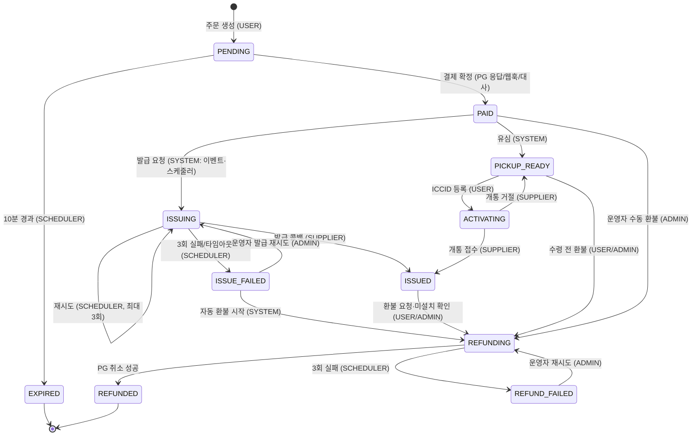

# 04. 상태 설계 (질문 2)

> 질문 2: 상태 목록과 허용되는 전이를 그려 주세요. **결제는 됐는데 발급이 안 된 주문**은 어느 상태에 있고, **누가**(사용자 요청 / 스케줄러 / 콜백 / 운영자) 그 주문을 끝냅니까? 사용자가 결제 직후 **브라우저를 닫으면** 어떻게 됩니까?

## 1. 상태를 세 개로 나눈 이유

나는 상태를 **주문 / 결제 / 프로필(설치)** 세 갈래로 나눴다.

처음에는 주문 상태 하나에 모든 의미를 담으려 했다(`PAID_AND_ISSUED_AND_INSTALLED`...). 그런데 결제는 "부분 취소"가, 설치는 "QR 열람 → 설치 → 개통"이 각각 따로 움직인다. 이를 하나에 담으면 조합 수가 폭발한다. 그래서 다음처럼 나눴다.

| 상태 | 대답하는 질문 | 주인 |
|---|---|---|
| **주문 상태** (`sim_order.status`) | 이 주문이 지금 **어디까지 진행**됐나? 다음에 누가 무엇을 해야 하나? | 우리 서비스 |
| **결제 상태** (`payment.status`) | 돈이 **실제로** 어떤 상태인가? | PG의 사실을 반영 |
| **설치 상태** (`sim_profile.install_status`) | SIM이 사용자 기기에서 **어떤 상태**인가? | 공급사의 사실을 반영 |

## 2. 주문 상태

| 상태 | 뜻 | 최종? |
|---|---|---|
| `PENDING` | 주문 생성, 결제 전. `expires_at`(10분)까지 결제 가능 | |
| `EXPIRED` | 10분 안에 결제하지 않음 | ✅ |
| `PAID` | 결제 확정. 아직 발급 요청 전 | |
| `ISSUING` | 공급사에 발급 요청함(또는 재시도 중). 콜백 대기 | |
| `ISSUED` | 프로필(ICCID/활성화 코드) 수령 완료. 이후는 설치 상태가 담당 | ✅* |
| `PICKUP_READY` | (유심) 공항 수령 대기. ICCID 입력을 기다림 | |
| `ACTIVATING` | (유심) ICCID로 공급사에 개통 요청함 | |
| `ISSUE_FAILED` | 발급 최종 실패(재시도 상한 초과). 곧바로 환불로 넘어감 | |
| `REFUNDING` | 환불 진행 중(PG 취소 요청·재시도) | |
| `REFUNDED` | 전액 환불 완료 | ✅ |
| `REFUND_FAILED` | 환불 재시도 상한 초과. **운영자가 처리해야 함** | ⚠️ 운영자 |

\* `ISSUED`에서도 미설치 상태면 사용자가 환불을 요청할 수 있으므로 `REFUNDING`으로 갈 수 있다.

### 상태 전이도



### 허용 전이표 (코드의 `OrderStatus.canTransitTo()`와 1:1)

| from \ to | 허용되는 to | 주체 |
|---|---|---|
| PENDING | PAID, EXPIRED | PG / SCHEDULER |
| PAID | ISSUING, PICKUP_READY, REFUNDING | SYSTEM / ADMIN |
| ISSUING | ISSUING(재시도), ISSUED, ISSUE_FAILED | SCHEDULER / SUPPLIER |
| PICKUP_READY | ACTIVATING, REFUNDING | USER / ADMIN |
| ACTIVATING | ISSUED, PICKUP_READY | SUPPLIER / SYSTEM |
| ISSUED | REFUNDING | USER / ADMIN (미설치일 때만) |
| ISSUE_FAILED | REFUNDING, ISSUING | SYSTEM / ADMIN |
| REFUNDING | REFUNDED, REFUND_FAILED | PG / SCHEDULER |
| REFUND_FAILED | REFUNDING | ADMIN |
| EXPIRED, REFUNDED | (없음) | - |

## 3. 결제 상태

| 상태 | 뜻 |
|---|---|
| `READY` | PG 승인 요청 직전에 만든 행. **결과를 아직 모름** (타임아웃이면 여기서 멈춤) |
| `APPROVED` | 승인됨 |
| `FAILED` | 승인 거절 |
| `PARTIAL_CANCELED` | 일부 취소됨 (`canceled_amount < amount`) |
| `CANCELED` | 전액 취소됨 |

`READY`가 중요하다. "PG에 요청은 보냈는데 답을 못 받은 상태"를 표현하는 유일한 방법이기 때문이다. 이 상태로 1분 넘게 남아 있는 결제는 대사(reconciliation) 스케줄러가 PG에 조회해서 확정한다(`06` §4).

## 4. 설치 상태 → `07_설치추적_만료.md`

`ISSUED → QR_VIEWED → INSTALLED → ACTIVE → EXPIRED`가 기본 흐름이고, 별도로 `DELETED`가 있다.

## 5. "결제는 됐는데 발급이 안 된 주문"은 어디에 있고, 누가 끝내나

이런 주문은 `PAID` 또는 `ISSUING` 상태에 있다. **모든 비최종 상태에는 그 상태를 끝내는 주체가 반드시 있어야 한다**는 것이 내 설계 원칙이다. 끝내는 주체가 없는 상태가 있으면 그 주문은 영원히 멈춘다.

| 머무는 상태 | 정상적으로 끝내는 주체 | 그게 안 될 때 끝내는 주체 | 최후 |
|---|---|---|---|
| `PAID` | **이벤트**(`@TransactionalEventListener` + `@Async`)가 즉시 발급 요청 | **발급 스케줄러**(30초 주기): `PAID`로 30초 넘게 남은 주문을 다시 요청 | - |
| `ISSUING` | **공급사 콜백**이 ISSUED로 | **발급 스케줄러**: 요청 후 2분 안에 콜백이 없으면 재요청(최대 3회) | 3회 초과 → `ISSUE_FAILED` |
| `ISSUE_FAILED` | **시스템**이 즉시 자동 환불 시작 → `REFUNDING` | 운영자가 발급 재시도 | - |
| `REFUNDING` | **PG 취소 성공** → `REFUNDED` | **환불 스케줄러**: 1차 즉시 → 2차 1분 뒤 → 3차 5분 뒤 (백오프) | 3회 실패 → `REFUND_FAILED` |
| `REFUND_FAILED` | **운영자**: 어드민 이상 건에서 확인 후 재시도하거나 PG 관리자 화면에서 수동 처리 | - | 어드민 이상 건에 계속 노출됨 |

그래서 "결제됐는데 발급도 환불도 안 된 주문이 **흔적 없이** 남는" 경우는 없다. 최악의 경우에도 `REFUND_FAILED`로 어드민 화면에 빨갛게 남는다.

### 왜 바로 환불하지 않고 3번 재시도하나
공급사 장애는 대부분 일시적이다(타임아웃, 잠깐의 5xx). 사용자는 SIM을 원해서 결제했으므로, 바로 환불하는 것보다 몇 번 더 시도해서 발급해 주는 편이 사용자에게 낫다. 다만 무한히 기다리게 할 수는 없어서 **약 6분**(2분 × 3회) 안에 결론을 낸다.

### 늦게 온 발급 콜백 (`ISSUE_FAILED`/`REFUNDING` 이후 도착)
환불을 시작한 뒤에 공급사 콜백이 도착할 수 있다. 이때는 **프로필을 붙이지 않고** `callback_log.result = LATE_AFTER_FAIL`로 남겨 어드민 이상 건에 노출한다. 실제 서비스라면 공급사에 그 프로필을 회수(취소)하라고 요청해야 한다. 이번 범위에서는 "운영자 확인 대상"으로만 둔다(한계).

## 6. 사용자가 결제 직후 브라우저를 닫으면?

**아무 문제 없다. 발급은 브라우저가 아니라 서버가 시작하고 끝까지 책임지기 때문이다.**

1. 결제 승인 결과는 두 경로로 온다. 하나는 브라우저가 기다리던 **승인 API 응답**, 다른 하나는 PG가 서버로 직접 보내는 **웹훅**이다. 브라우저를 닫아 승인 API 응답 처리가 중단되더라도 서버는 웹훅으로 결제를 확정한다
   - 엄밀히 말하면 승인 API 호출은 브라우저가 아니라 **우리 서버가** PG로 보낸다. 브라우저를 닫아도 서버의 요청은 계속 진행된다
2. 결제가 확정되면(`PAID` 커밋) 서버 내부 이벤트가 발급을 시작한다. 클라이언트가 "이제 발급해 줘"라고 호출하는 구조가 **아니다**
3. 이벤트가 유실되면(그 순간 서버 재시작 등) 스케줄러가 `PAID` 상태로 남은 주문을 30초 안에 다시 집어 간다
4. 사용자가 나중에 "내 SIM"에 들어오면 이미 `ISSUED` 상태다

> 과제 문구 "발급을 클라이언트가 이어서 호출하는 구조라면 그 호출이 오지 않을 때 어떻게 되는지 설계하세요"에 대한 내 답은 **"그 구조를 처음부터 택하지 않았다"**이다.

## 7. 유심(USIM) 흐름

1. 결제가 확정되면 공급사 발급 대신 `PAID → PICKUP_READY`로 간다. 화면에는 "공항 카운터에서 카드를 받으세요"를 보여 준다
2. 사용자가 카드 뒷면의 ICCID를 입력한다
   - **형식 검사**: 19~20자리 숫자이고 `89`(통신용)로 시작해야 한다
   - **체크 디지트**: 마지막 자리가 **Luhn 알고리즘**(신용카드 번호 검증과 같은 방식) 결과와 맞아야 한다
   - **중복 검사**: `sim_profile.iccid UNIQUE`. 이미 다른 주문에 등록되어 있으면 거절한다. 동시에 두 명이 같은 ICCID를 입력해도 DB 제약 때문에 한 명만 성공한다
3. 통과하면 `PICKUP_READY → ACTIVATING` 상태를 선점한다 → 트랜잭션 밖에서 공급사 `POST /usim/activate`를 호출한다
   - 접수되면 `ISSUED`가 되고 설치 상태는 `ISSUED`로 시작한다(실물 카드라 QR은 없음)
   - 거절되면(공급사가 모르는 ICCID 등) `PICKUP_READY`로 되돌리고 ICCID 등록을 해제한다. 사용자는 다시 입력할 수 있다
4. **유심 환불 정책(가정)**: ICCID를 등록했다는 것은 카드를 이미 받았다는 뜻이므로 등록 후에는 환불하지 않는다. 등록 전(`PICKUP_READY`)에는 환불할 수 있다. 과제에 명시가 없어서 내가 정한 가정이며 README에 적는다

## 8. 상태 변경은 한 곳에서만

모든 상태 변경은 `StatusTransitionService`를 거친다.

```java
// 개념 코드
@Transactional
public boolean transit(Long orderId, OrderStatus from, OrderStatus to, Actor actor, Signal signal, String reason) {
    if (!from.canTransitTo(to)) throw new IllegalStateTransitionException(from, to);
    int updated = orderRepository.updateStatusIf(orderId, from.name(), to.name()); // UPDATE ... WHERE id=? AND status=?
    if (updated == 0) return false;           // 다른 요청이 먼저 바꿨음 → 조용히 종료
    historyRepository.save(StatusHistory.order(orderId, from, to, actor, signal, reason));
    return true;
}
```

이렇게 하면 다음 세 가지가 함께 보장된다.
1. **허용되지 않은 전이는 코드에서 막힌다** (`canTransitTo`)
2. **동시에 두 요청이 와도 한 번만 바뀐다** (조건부 UPDATE, [L3 상태 선점](learn/L3_동시성_핵심개념.md#3-상태-선점))
3. **바뀌면 반드시 이력이 남는다** (같은 트랜잭션에서 status_history 저장) → 어드민 타임라인의 원천

## 9. 한계

- 부분 환불 시 주문 상태는 바뀌지 않고 결제 상태만 `PARTIAL_CANCELED`가 된다. "부분 환불된 주문"을 목록에서 보려면 결제 상태 필터를 써야 한다
- 늦게 온 발급 콜백의 프로필 회수는 구현하지 않았다
- 유심 환불 정책은 내가 정한 가정이다
