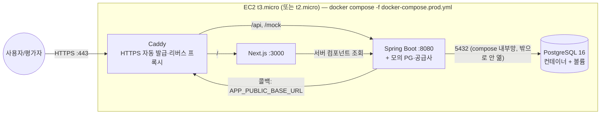

# 10. 배포 계획

> 2.6: 접속 가능한 **프론트엔드 URL**(백엔드 URL도 있으면 좋음). 배포 환경에서도 **모의 공급사 콜백이 실제로 돌아와야** 하고 콜백 주소를 어떻게 잡았는지 적는다. **어디에, 왜** 배포했는지와 **막혔던 지점과 해결 방법**(가장 궁금해하는 부분)을 적는다. **무료 티어**로 하고, 서버가 잠들어 스케줄러가 멈추는 문제를 어떻게 다뤘는지도 좋은 이야깃거리다.

실제 절차는 [L5 AWS 프리티어 배포](learn/L5_AWS_프리티어_배포.md)에 있다. 이 문서는 **결정과 근거**만 다룬다.

## 1. 결정: AWS 프리티어 — EC2 1대에 docker compose로 전부 (DB도 컨테이너)

- 실제 파일: `docker-compose.prod.yml`(4개 서비스), `deploy/Caddyfile`, `deploy/prod.env.example`(서버 `.env`의 키 목록)
- 이미지는 CD(GitHub Actions)가 빌드해 GHCR에 올리고, EC2는 `pull`만 한다(1GB 서버에서 빌드하지 않는다)
- 로컬에서 같은 파일을 띄워 확인했다(2026-10-21): 화면, Caddy → Spring 라우팅, 결제 → 공급사 콜백이 Caddy를 거쳐 돌아와 ISSUED, `down` → `up` 후에도 데이터 유지. 메모리는 backend 약 424MB, frontend 43MB, postgres 38MB, Caddy 16MB. HTTPS 인증서 발급은 공개 IP가 있어야 해서 EC2에서 확인한다

## 2. 왜 이렇게 골랐나

| 대안 | 장점 | 버린 이유 |
|---|---|---|
| **EC2 한 대 + docker compose, DB도 컨테이너 (채택)** | **서버가 잠들지 않음** → 스케줄러가 멈추지 않음. 로컬 `docker-compose.yml`과 같은 구성이라 로컬에서 되면 서버에서도 된다. 만들 AWS 리소스가 EC2 하나 | 서버·보안 그룹·HTTPS를 직접 설정해야 함. DB 백업은 직접(`pg_dump`) |
| EC2 + RDS (처음 계획) | 관리형 DB(자동 백업·패치), 실무에서 흔한 구성 | RDS·DB 보안 그룹을 따로 만들고 과금을 확인할 곳이 는다. 로컬과 구성이 달라진다. 과제 시연 데이터에는 백업 이득이 작다고 봤다 |
| Vercel(프론트) + Render(백엔드) + Neon(DB) | 설정이 가장 쉬움 | Render 무료 인스턴스는 **15분간 요청이 없으면 잠든다** → 스케줄러가 멈춰 "결제됐는데 발급 안 된 주문"을 아무도 끝내지 못함 |
| Elastic Beanstalk | 배포 자동화 | 내부에서 결국 EC2를 쓰고, 추상화가 한 겹 더 있어 설명하기 어려움 |
| Lightsail | 고정 요금으로 단순함 | 프리티어 조건이 다름. EC2 경험이 더 범용적이라고 판단 |

**1년차 말투**: "처음엔 Vercel과 Render 조합이 쉬워 보였는데, Render 무료 서버는 15분 동안 요청이 없으면 잠든다는 걸 문서에서 봤습니다. 제 설계는 '결제됐는데 발급 안 된 주문'을 스케줄러가 끝내는 구조라서, 서버가 잠들면 그 약속이 깨집니다. 그래서 잠들지 않는 EC2를 골랐고, AWS는 ✍️(처음/써 본 적 있음)이라 [과정]을 적었습니다."

### 프론트까지 EC2에 올린 이유
Vercel에 프론트를 올리면 HTTPS 페이지(Vercel)에서 HTTP 백엔드(EC2)를 호출할 때 브라우저가 **Mixed Content**로 막는다. 피하려면 EC2에도 HTTPS가 필요하다. 어차피 EC2에 HTTPS(Caddy)를 붙일 거라면 프론트도 같은 서버에 두는 쪽이 **도메인 하나, CORS 없음, 설정 한 곳**으로 단순하다고 판단했다.

## 3. 콜백 주소를 어떻게 잡았나

- 환경변수 **`APP_PUBLIC_BASE_URL`** = 외부에서 접근 가능한 주소(예: `https://3-35-12-34.sslip.io`)
- 우리 서비스가 모의 공급사에 발급을 요청할 때 `callbackUrl = APP_PUBLIC_BASE_URL + "/api/webhooks/supplier"`를 **요청 본문에 담아** 보낸다. 모의 공급사는 그 주소로 콜백한다
- 같은 서버 안이지만 **일부러 공개 주소로 돌아 나가게** 해서, 실제 외부 공급사가 우리를 호출하는 것과 같은 경로(DNS → Caddy → Spring)를 탄다. 덕분에 배포 환경에서 콜백이 실제로 돌아오는지 검증할 수 있다
- 로컬에서는 `http://localhost:8080`, docker compose에서는 `http://backend:8080`이다

> **sslip.io**: `3-35-12-34.sslip.io`처럼 IP를 넣은 도메인을 그 IP로 연결해 주는 무료 DNS 서비스. 도메인을 사지 않고도 Caddy가 Let's Encrypt HTTPS 인증서를 받을 수 있다.

## 4. 서버가 잠들어 스케줄러가 멈추는 문제

- **EC2는 잠들지 않는다.** 이 문제를 회피하는 것이 EC2를 고른 이유 중 하나다
- 그래도 서버는 재시작될 수 있다(배포, 장애). 대비책은 다음과 같다
  1. docker compose의 `restart: unless-stopped`로 자동 재기동한다
  2. **모든 "할 일"이 DB 상태로 남아 있다**(PAID, ISSUING, REFUNDING, next_poll_at). 서버가 다시 뜨면 스케줄러가 첫 실행에서 밀린 일을 처리한다. 메모리에만 있던 `@Async` 작업은 사라지지만 DB 상태가 남아 있으므로 복구된다
- 만약 슬립형 호스팅을 썼다면 외부 cron(예: 5분마다 `/actuator/health` 호출)으로 깨우는 방법이 있다. 다만 이는 무료 정책의 취지를 우회하는 것이고, 깨어 있는 시간이 늘면 월 무료 한도를 넘을 수 있다

## 5. 막힐 것으로 예상되는 지점 (실제 겪은 내용으로 교체)

> ✍️ 배포하면서 **실제로** 막힌 것을 아래 형식으로 남긴다. 평가자가 "가장 궁금해하는 부분"이다.
> `증상 → 원인 추정 → 시도한 것 → 해결 / 미해결`

예상 후보와 미리 아는 해결 방법은 다음과 같다.
| 후보 | 원인 | 해결 |
|---|---|---|
| EC2에서 `docker build` 중 서버가 멈춤 | 메모리 1GB에서 Gradle·Next 빌드 | 로컬에서 `--platform linux/amd64`로 이미지를 빌드해 레지스트리에 push, 또는 swap 2GB 추가 |
| 컨테이너가 계속 재시작 / `Killed` | 메모리 1GB에 JVM·Node·Postgres | swap 2GB, JVM `-Xmx384m`, postgres `shared_buffers=64MB` (`docker-compose.prod.yml`) |
| 콜백이 돌아오지 않음 | `APP_PUBLIC_BASE_URL`이 localhost로 설정됨 | 공개 주소로 설정, 컨테이너 안에서 `curl`로 확인 |
| HTTPS 인증서 발급 실패 | 80/443 포트 미개방 | 보안 그룹에 80, 443 허용 |
| 만료 시각이 9시간 틀림 | 서버 타임존 UTC | 코드에서 `Asia/Seoul` 명시(`07` §4) |
| 예상치 못한 과금 | 퍼블릭 IPv4, 스토리지, 데이터 전송 | Budget 알림 설정(L5) |

## 6. 트래픽이 10배가 되면 무엇부터 손보나 (인터뷰 I9)

**원칙: 추측하지 말고 먼저 측정한다.** CloudWatch의 CPU, **CPU 크레딧 잔량**, 메모리와 PostgreSQL 커넥션 수를 본다.

예상되는 순서는 다음과 같다.
1. **EC2 t3.micro의 CPU 크레딧과 메모리 1GB**: t 계열은 평소 성능의 일부만 쓰다가 크레딧으로 잠깐 높은 성능을 낸다(버스트). 트래픽이 지속되면 크레딧이 바닥나 느려진다. JVM·Node·PostgreSQL이 1GB를 나눠 쓰는 것도 한계다 → **인스턴스 크기를 키우고, DB를 RDS 같은 관리형으로, 프론트를 Vercel/CloudFront로 분리**한다
2. **DB 커넥션**: Spring의 커넥션 풀(Hikari 기본 10)과 PostgreSQL `max_connections=30`(메모리 때문에 낮춤). 발급 대기 화면의 2초 폴링이 10배가 되면 조회가 급증한다 → 폴링 간격을 늘리고, 상태 조회 API를 가볍게(인덱스, 필요한 컬럼만) 만든다
3. **스케줄러와 API가 같은 서버에 있음**: 트래픽이 늘면 스케줄러가 느려지고 반대도 마찬가지다 → 스케줄러를 별도 인스턴스(워커)로 분리하고, 여러 대가 되면 **ShedLock**이나 `SKIP LOCKED`로 중복 실행을 막는다
4. 모의 PG·공급사가 같은 앱에 있음 → 실제 환경에서는 원래 외부 시스템이므로 문제가 되지 않는다

## 7. 가산점 연결: 자동 배포

시간이 남으면 GitHub Actions에서 테스트 → 이미지 빌드 → GHCR(GitHub 컨테이너 레지스트리, 무료) push → SSH로 EC2에서 `docker compose pull && up -d`를 실행하는 흐름을 만든다. 1GB 메모리 문제도 함께 해결된다(빌드를 Actions가 하므로).
