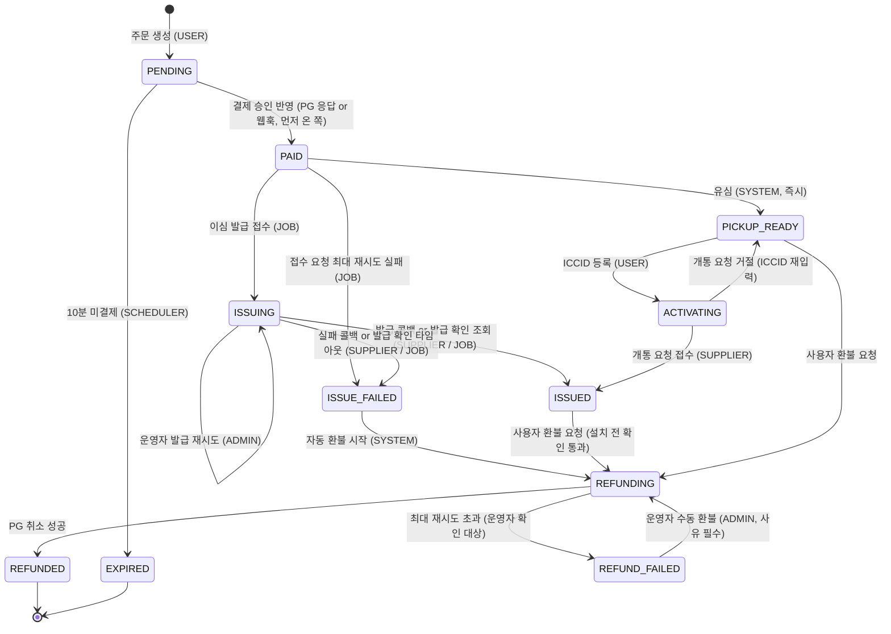
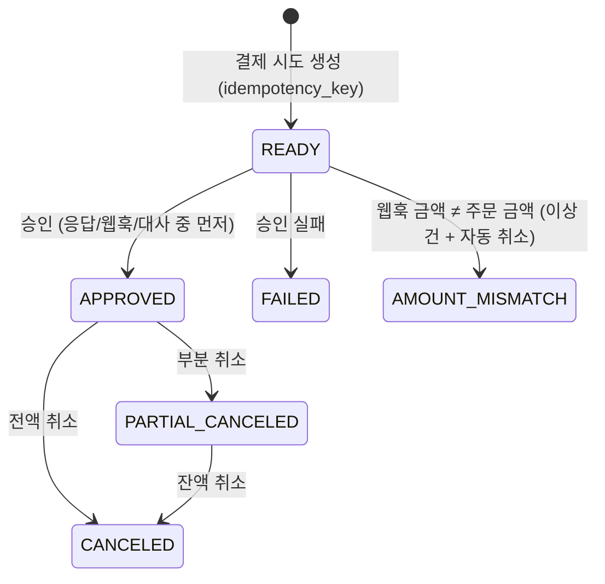

# ROAMPASS 과제 분석 · 설계 가이드

> 이 문서는 "무엇을, 왜, 어떤 순서로 만들지"를 정리한 작업 기준서다.
> 구현하면서 결정이 바뀌면 이 문서가 아니라 `docs/DECISIONS.md`에 기록하고, 여기에는 링크만 남긴다.
> 요구사항 ID(`REQ-x.y`)는 커밋 메시지의 `관련:` 줄과 `docs/PROGRESS.md` 체크리스트에서 그대로 쓴다.

---

## 0. 세 줄 요약

1. 이 과제는 **완성된 코드가 아니라 "이해하고 만들었는가"** 를 본다. 점수의 30%가 "설명 가능성"이고, 2차 인터뷰가 사실상 본 전형이다.
2. 기술적으로 가장 중요한 건 **"돈과 SIM이 어긋나지 않는 것"** 이다. 중복 통지에 두 번 결제되거나, 결제됐는데 발급도 환불도 안 된 주문이 흔적 없이 남으면 크게 감점된다.
3. 그래서 화면 수를 늘리기보다 **결제 → 발급 → 설치 추적 한 줄기를 끝까지 믿을 수 있게** 만들고, 모든 판단을 README에 1년차 말투로 설명할 수 있게 남긴다.

---

## 1. 과제 분석

### 1.1 평가 기준 (그대로 시간 배분에 쓴다)

| 영역 | 비중 | 이 과제에서 의미하는 것 | 우리가 할 일 |
|---|---|---|---|
| 이해도·설명 가능성 | 30% | README 8개 질문 답 + 인터뷰에서 내 코드 설명 | 결정마다 DECISIONS.md, 구현 후 `explain` 스킬로 설명 연습 |
| 결제·발급 정합성 | 25% | 중복 방지, 멱등성, "결제됐는데 발급 안 됨" 처리, 상태 전이, 데이터 모델 | 유니크 제약 + 조건부 UPDATE, 서버 주도 발급, 자동 환불 |
| 기술 선택 근거 | 15% | 무엇을 골랐는지가 아니라 **왜** 골랐는지 | 고려했다가 버린 선택지까지 기록 |
| 요구사항 충족도 | 15% | 필수 6개, 특히 **어드민 이상 건**과 **설치 추적** | 미구현은 README에 명시 (감점 완화) |
| 테스트 | 10% | 양보다 "무엇을 검증했는지" | 동시성 2개 + 발급 실패 보상 + 만료 계산 |
| 배포·재현성 | 5% | 접속 가능한 URL, README 커맨드로 로컬 재현 | clean clone 으로 직접 확인 |

### 1.2 감점 항목 (하나라도 걸리면 치명적)

- README가 없거나 실행 커맨드가 틀려서 실행이 안 됨
- 기술 선택에 이유가 전혀 없음
- 중복 통지·중복 콜백에 결제나 발급이 두 번 처리됨
- 결제됐는데 발급도 환불도 안 된 주문이 아무 흔적 없이 남음
- 서명 검증 없이 공급사 콜백을 그대로 믿음
- 시크릿(DB 비밀번호·API 키·서명 키)이 저장소에 커밋됨 → **git 훅으로 막아 둠** (`.githooks/pre-commit`)
- `assertTrue(true)` 류의 아무것도 검증하지 않는 테스트
- 제출한 코드를 본인이 설명하지 못함

### 1.3 감점하지 않는 것 (시간 쓰지 말 것)

UI 디자인·CSS, 컴포넌트 라이브러리 미사용, 커버리지 수치, 커밋 개수, AI 사용, 실제 기기 설치, 본격 회원 시스템(헤더 `X-User-Id` / `X-Admin-Id`로 충분)

### 1.4 시간이 부족할 때 포기 순서 (FAQ)

구현 우선순위: **결제(2) → 발급(3) → 어드민(5) → 설치 추적(4) → 주문(1) → 사용자 화면(6)**
뒤에서부터 포기하고 README에 적는다. 유심은 이심보다 먼저 포기해도 된다. **8개 질문 답은 포기 대상이 아니다.**

> 단, 주문(1)이 없으면 결제를 테스트할 수 없으므로 "최소한의 주문 생성"은 결제보다 먼저 만든다.
> 우선순위는 "무엇을 끝까지 다듬을지"의 순서로 읽는다.

### 1.5 출제자가 진짜 묻는 두 문장

> "결제 직후 사용자가 브라우저를 닫아 버리면 이 주문은 어떻게 끝나는가"
> "이 사용자가 SIM을 설치했다는 것을 우리는 무엇으로 아는가"

이 두 문장에 답하는 구조가 설계의 중심이다.
- 첫 번째 → **발급을 클라이언트가 아니라 서버(스케줄러 job)가 이어 간다.**
- 두 번째 → **우리가 직접 아는 건 "QR 열람"뿐이고, 설치·개통은 공급사 콜백(빠질 수 있음)과 상태 조회(느림)를 조합해서 "추정"한다.**

---

## 2. 요구사항 분해 (REQ ID)

### REQ-1 요금제 조회 · 주문 생성
| ID | 내용 | 완료 기준 |
|---|---|---|
| REQ-1.1 | 국가·사용 일수·데이터 용량별 요금제 목록, 각 요금제는 ESIM/USIM 중 하나 | `GET /api/plans?country=&days=&simType=` |
| REQ-1.2 | 요금제 + 여행 시작일로 주문 생성, 최초 상태 `PENDING` | 금액은 서버가 요금제에서 복사 (클라이언트 금액 불신) |
| REQ-1.3 | 결제 대기 만료 (10분) | `expires_at`, 스케줄러가 `EXPIRED` 처리 + 결제 요청 시 만료 검사 |

### REQ-2 결제 (모의 PG)
| ID | 내용 | 완료 기준 |
|---|---|---|
| REQ-2.1 | 모의 PG 승인 API: 금액 + 주문번호 → `approved` / `failed` | `POST /mock-pg/payments` |
| REQ-2.2 | 승인 결과 웹훅 한 번 더, 지연·실패·중복 통지 조절 가능 | 쿼리 파라미터 + 런타임 설정 API |
| REQ-2.3 | 취소 API: 전액 / 부분 | `POST /mock-pg/payments/{tid}/cancel {amount}` |
| REQ-2.4 | 승인 응답 + 웹훅, 웹훅 N번 → 결제 1번만 처리 | 동시성 테스트로 증명 |
| REQ-2.5 | 웹훅 금액 ≠ 주문 금액 → 결제 완료 처리 금지 | 이상 건으로 분류 + 테스트 |

### REQ-3 발급 (이심) · 수령 대기 (유심)
| ID | 내용 | 완료 기준 |
|---|---|---|
| REQ-3.1 | 결제 완료 후 공급사 발급 요청, 공급사는 접수만 즉시 응답 | `202 { supplierOrderNo }` |
| REQ-3.2 | 공급사 콜백 서명 검증 | `X-Signature = HMAC-SHA256(rawBody, secret)` |
| REQ-3.3 | 콜백 중복·순서 뒤바뀜에도 한 주문에 프로필 1개 | 동시성 테스트로 증명 |
| REQ-3.4 | 결제됐는데 발급 최종 실패 → 자동 환불 or 운영자가 바로 아는 흔적 | 자동 환불 + 이상 건 + 테스트 |
| REQ-3.5 | 결제 직후 브라우저를 닫아도 발급 끝까지 진행 | 서버 주도 job (클라이언트 호출에 의존 X) |
| REQ-3.6 | 유심: `PICKUP_READY` → ICCID 입력 시 공급사 개통 요청 | `POST /api/orders/{no}/iccid` |
| REQ-3.7 | ICCID 자릿수·체크 디지트(Luhn) 검증, 다른 주문에 등록된 ICCID 거절 | 단위 테스트 + 유니크 제약 |

### REQ-4 설치 · 사용 추적
| ID | 내용 | 완료 기준 |
|---|---|---|
| REQ-4.1 | SIM마다 설치 상태 (ISSUED / QR_VIEWED / INSTALLED / ACTIVE / EXPIRED) | `sim_profile.install_status` |
| REQ-4.2 | 공급사 상태 조회 + 개통 이벤트 콜백(가끔 빠짐) 조합 | 콜백 = 빠른 길, 폴링 = 보정 |
| REQ-4.3 | 공급사 UTC / 운영 KST, 만료일 계산이 틀리지 않음 | 경계값 테스트 |
| REQ-4.4 | 설치·개통된 SIM 환불 불가, 늦은 신호 고려 | 환불 요청 시점 실시간 조회 |

### REQ-5 어드민
| ID | 내용 | 완료 기준 |
|---|---|---|
| REQ-5.1 | 주문 목록: 결제 상태 / 발급·설치 상태 / SIM 종류 / 기간 필터 + 페이지네이션 | `GET /api/admin/orders` |
| REQ-5.2 | 주문 상세: 결제·발급·설치 이력을 한 줄 타임라인 (언제, 무엇이, 누가/어떤 신호로) | `status_history` 시간순 |
| REQ-5.3 | 이상 건 모아 보기 (기준은 직접 정함) | §5.9 기준표 |
| REQ-5.4 | 수동 환불·발급 재시도, 운영자·사유 기록, 두 운영자 동시 클릭에도 1회 | 조건부 UPDATE + 테스트 |
| REQ-5.5 | PG 취소 실패(타임아웃, 5xx) 재시도, 무한 재시도 금지, 최대 횟수 후 운영자 확인 | `refund_attempt` 최대 3회 |

### REQ-6 사용자 화면
| ID | 내용 | 완료 기준 |
|---|---|---|
| REQ-6.1 | 구매: 요금제 선택 → 결제 → 발급 결과 대기 (늦어도 사용자가 할 수 있는 일 존재) | 폴링 + 안내 + 내 SIM 링크 |
| REQ-6.2 | 내 SIM 목록·상세: 결제 금액, 발급·설치 상태, QR/활성화 코드, 남은 기간, 환불 가능 여부 | |
| REQ-6.3 | 유심 ICCID 등록 화면 | |

### D — 제출물
| ID | 내용 |
|---|---|
| D-1 | README: 실행 방법 / 8개 질문 답 / 시연 방법 / 배포 / 아키텍처·ERD·상태도 / 미구현 / 투입 시간·AI 사용처 |
| D-2 | Flyway 마이그레이션 (빈 DB에서 스키마 + 시드 요금제 재현) |
| D-3 | 테스트: 중복 통지·중복 콜백 동시성, 결제됐는데 발급 실패, (권장) UTC→KST 만료 |
| D-4 | 배포 URL (사용자 + 어드민), 배포 환경에서 공급사 콜백이 실제로 돌아옴 |
| D-5 | squash 없는 커밋 히스토리 |

---

## 3. 기술 선택 (README Q1의 원재료)

> 과제가 정한 것: **Next.js / Spring / 관계형 DB**. 나머지(2.2 표의 "자유" 칸)는 아래처럼 정했다.
> "익숙해서"도 좋은 답이다. 단, 본인 경험과 다르면 반드시 본인 말로 바꿔 적는다.

| 영역 | 선택 | 왜 | 고려했다가 버린 것 |
|---|---|---|---|
| DB | **MySQL 8.4** | 익숙해서. 이번 과제에 필요한 기능(유니크 제약, `SELECT … FOR UPDATE SKIP LOCKED`, 트랜잭션)이 MySQL 8에 다 있다 | PostgreSQL(회사가 쓰지만 이번엔 익숙한 쪽으로 정합성 설계에 집중) |
| 백엔드 언어 | **Java 21** | 로컬에 JDK 21이 있고 자료가 가장 많아 막혔을 때 빨리 찾을 수 있다 | Kotlin (새 언어까지 배우면 정합성 설계에 쓸 시간이 줄어듦) |
| 빌드 | **Gradle (wrapper)** | Spring Initializr 기본값, wrapper 덕분에 리뷰어 PC에 Gradle이 없어도 실행 가능 | Maven |
| ORM/쿼리 | **Spring Data JPA + 상태 전이만 조건부 UPDATE (`@Modifying` JPQL)** | 조회·저장은 JPA로 빠르게, "중복 처리 방지"가 걸린 상태 변경은 `UPDATE … WHERE status = ?`의 영향받은 행 수로 판단해야 확실하다 | MyBatis(SQL은 명확하지만 매핑 코드가 늘어남), JPA만 사용(엔티티를 읽고 바꾸는 방식은 동시에 두 요청이 읽으면 둘 다 바꿈 → @Version 필요) |
| 마이그레이션 | **Flyway** (`flyway-mysql`) | SQL 파일 그대로라 DDL을 그대로 보여줄 수 있고, 앱 시작 시 자동 적용 → "빈 DB에서 재현" 요건 충족 | Liquibase(XML/YAML 학습 비용), `ddl-auto`(운영 스키마를 코드가 몰래 바꿈) |
| 비동기 작업 | **DB 작업 테이블 + `@Scheduled` 폴러 + `FOR UPDATE SKIP LOCKED`** | 상태 변경과 "다음에 할 일"을 같은 트랜잭션에 저장 → 서버가 죽거나 잠들어도 DB에 남아 있어 깨어나면 이어서 처리. 별도 인프라 0개 (무료 티어) | Kafka/RabbitMQ/Redis 큐(무료 배포 부담, DB 저장과 메시지 발행이 따로 놀아 "저장은 됐는데 발행 실패" 문제가 새로 생김), `@Async`(메모리에만 있어 재시작 시 유실) |
| 모의 PG·공급사 | **같은 Spring 앱 안, 별도 패키지(`mock.pg`, `mock.supplier`), 호출은 진짜 HTTP** | 배포 대상을 하나로 줄이면서도 실제 외부 호출처럼 타임아웃·재시도를 테스트 가능. 나중에 분리하기 쉬움 | 별도 서버(배포 2배), 메서드 직접 호출(네트워크 실패를 흉내 못 냄) |
| 테스트 | **JUnit 5 + Testcontainers(MySQL)** | 동시성 테스트는 진짜 MySQL의 유니크 제약·락 동작을 봐야 의미가 있다 | H2(락·SKIP LOCKED 동작이 MySQL과 다름) |
| 프론트 라우터 | **Next.js App Router** | 조회 화면은 서버 컴포넌트로 바로 그리고, 결제·발급 대기처럼 상호작용 있는 부분만 클라이언트 컴포넌트로 분리 → 경계를 설명하기 쉬움 | Pages Router(자료는 많지만 신규 기본값이 App Router) |
| 데이터 패칭 | **서버 컴포넌트 fetch(`cache: 'no-store'`) + 클라이언트는 작은 폴링 훅** | 결제/발급 상태는 캐시하면 안 되는 데이터. 라이브러리 없이 동작을 직접 설명 가능 | TanStack Query(편하지만 설명할 개념이 늘어남), SSE(무료 호스팅 프록시·슬립 환경에서 연결 유지가 불안정) |
| 백엔드 호출 경로 | **Next Route Handler 프록시(`/api/*`) — 쿠키의 userId를 `X-User-Id` 헤더로** | CORS 설정 불필요, 브라우저에 백엔드 주소 노출 X | 브라우저 → Spring 직접 호출(CORS, 헤더 조작) |
| 배포 | **Vercel(프론트) + Render(백엔드, Docker) + 무료 MySQL 호스팅(Aiven 무료 플랜 1순위, 대안 TiDB Cloud Serverless)** | 전부 무료, Next.js는 Vercel이 가장 손이 덜 감 | Railway(무료 크레딧 소진형), Fly.io(신규 무료 없음) — **무료 정책은 자주 바뀌므로 배포 시점에 재확인** |

**MySQL이라서 주의할 점** (CLAUDE.md 불변 규칙에도 반영)
- `DATETIME(6)`은 시간대 정보가 없다 → **DB에는 무조건 UTC로 저장**(`spring.jpa.properties.hibernate.jdbc.time_zone=UTC`, JDBC URL `connectionTimeZone=UTC`), 화면/만료 표시에서만 KST로 변환. 여기서 틀리면 만료일이 9시간 밀린다.
- MySQL에는 PostgreSQL 같은 "부분 유니크 인덱스(`WHERE status='READY'`)"가 없다 → "대상당 진행 중 job 1개"는 `dedupe_key` 컬럼(UNIQUE, 완료 시 NULL로 비움)으로 구현. MySQL UNIQUE는 NULL 여러 개를 허용한다.
- `SKIP LOCKED`는 MySQL 8.0+ 기능 → docker 이미지 `mysql:8.4`, 호스팅도 8.0 이상인지 확인.
- 기본 격리 수준 REPEATABLE READ: 우리는 "읽고 판단"이 아니라 **조건부 UPDATE의 영향받은 행 수**로 판단하므로 격리 수준에 덜 민감하다. (UPDATE는 항상 최신 커밋된 행을 보고 행 락을 잡는다)
- 문자셋 `utf8mb4`.

---

## 4. 아키텍처

```
[Browser]
   │  (사용자 / 어드민 화면, 쿠키에 userId·adminId)
   ▼
[Next.js on Vercel]
   ├─ Server Components ── fetch ──┐
   └─ Route Handler /api/* (프록시, X-User-Id / X-Admin-Id 부착)
                                    ▼
[Spring Boot on Render] ───────────────────────────────────────────────
   api/        사용자·어드민 REST
   order/ payment/ issuance/ usim/ tracking/ refund/ admin/   ← 도메인
   job/        @Scheduled 폴러 (SKIP LOCKED)  — 발급, 발급 확인, 결제 대사, 환불 재시도, 프로필 상태 조회
   callback/   /callbacks/pg, /callbacks/supplier  (서명 검증 → callback_log → 처리)
   mock/pg/        모의 PG  (자기 테이블만 사용, 우리 서비스와는 HTTP로만 대화)
   mock/supplier/  모의 공급사 (자기 테이블만 사용, 지연 콜백을 HTTP로 PUBLIC_BASE_URL에 보냄)
   ────────────────────────────────────────────────────────────────────
                                    ▼
[MySQL 8 (Aiven 등)]
```

**모의 서버가 같은 앱에 있어도 지켜야 할 선**: 모의 PG/공급사 패키지는 우리 도메인 테이블·서비스를 절대 직접 참조하지 않는다. 오직 HTTP로만 대화한다. 그래야 "외부 호출이 실패하면?"을 진짜로 시험할 수 있다.

**콜백 주소**: 우리가 공급사에 발급을 요청할 때 `callbackUrl = ${PUBLIC_BASE_URL}/callbacks/supplier`를 같이 보낸다. 로컬은 `http://localhost:8080`, 배포는 Render URL. 배포 환경에서도 콜백이 실제로 HTTP로 돌아온다.

---

## 5. 데이터 모델

### 5.1 테이블 (부록 힌트 + 보강)

```text
sim_plan        id, country, days, data_mb, sim_type(ESIM/USIM), price, active
sim_order       id, order_no UNIQUE, user_id, plan_id, sim_type, amount, travel_start_date,
                status, expires_at(결제 대기 만료), version, created_at, updated_at
payment         id, order_id, idempotency_key UNIQUE, pg_tid UNIQUE NULL, amount, canceled_amount,
                status, requested_at, approved_at, failure_reason
sim_profile     id, order_id UNIQUE, iccid UNIQUE, activation_code, supplier_order_no UNIQUE,
                install_status, install_rank, deleted, qr_viewed_at, installed_at, activated_at,
                expires_at(사용 만료), used_mb, last_synced_at, next_poll_at
callback_log    id, source(PG/SUPPLIER), event_key UNIQUE, payload, signature_ok,
                result(PROCESSED/DUPLICATE/IGNORED/UNMATCHED/AMOUNT_MISMATCH/INVALID_SIGNATURE), received_at, processed_at
status_history  id, target(ORDER/PAYMENT/PROFILE/REFUND), target_id, order_id, from_status, to_status,
                actor(USER/SYSTEM/ADMIN:id/SUPPLIER/PG), reason, at
refund_attempt  id, payment_id, order_id, amount, status, attempt_count, max_attempts,
                last_error, next_retry_at, requested_by, reason, dedupe_key UNIQUE NULL, created_at
async_job       id, job_type, target_id, status(READY/RUNNING/DONE/DEAD), attempt_count, max_attempts,
                next_run_at, last_error, dedupe_key UNIQUE NULL, created_at, updated_at
mock_pg_payment / mock_supplier_order  — 모의 서버 전용 (우리 도메인과 공유 X)
```

### 5.2 "중복을 막는 진짜 장치" 목록 (README Q3의 원재료)

| 위험 | 막는 장치 | 위치 |
|---|---|---|
| 결제 버튼 연타 / 타임아웃 후 재시도 | `payment.idempotency_key UNIQUE` (클라이언트가 결제 시도마다 UUID 생성, 재시도 땐 같은 키) | DB 제약 |
| 같은 PG 웹훅 N번 | `callback_log.event_key UNIQUE` (`PG:{tid}:{eventType}`) | DB 제약 |
| 승인 응답과 웹훅이 동시에 도착 | `UPDATE payment SET status='APPROVED' … WHERE id=? AND status='READY'` → 영향 1행인 쪽만 후속 처리 | 조건부 UPDATE |
| 같은 공급사 콜백 N번 | `callback_log.event_key UNIQUE` (`SUPPLIER:{supplierOrderNo}:{eventType}`) | DB 제약 |
| 한 주문에 프로필 2개 | `sim_profile.order_id UNIQUE`, `iccid UNIQUE`, `supplier_order_no UNIQUE` | DB 제약 (최후 방어선) |
| 같은 job이 두 워커에서 동시 실행 | `SELECT … FOR UPDATE SKIP LOCKED` + `async_job.dedupe_key UNIQUE` | DB 락 + 제약 |
| 두 운영자가 동시에 "수동 환불" | `UPDATE sim_order SET status='REFUNDING' WHERE id=? AND status IN (…)` → 1행인 쪽만 환불 생성 | 조건부 UPDATE |
| 설치 상태가 늦은 신호 때문에 뒤로 감 | `UPDATE sim_profile SET install_status=?, install_rank=? WHERE id=? AND install_rank < ?` | 조건부 UPDATE |

**왜 이 조합인가 (버린 것 포함)**
- **유니크 제약**: DB가 보장하므로 앱 버그·동시성과 무관하게 "두 개가 생기는 것"을 막는다. 하지만 "상태를 두 번 바꾸는 것"은 못 막는다.
- **조건부 UPDATE**: "READY일 때만 APPROVED로"처럼 상태 전이를 원자적으로 만든다. 락을 오래 잡지 않고, 영향받은 행 수(0 또는 1)로 "내가 처음인지"를 바로 안다.
- **비관적 락(`SELECT … FOR UPDATE`)으로 전부 처리**: 가능하지만 락 잡는 범위를 실수하기 쉽고, 외부 호출을 락 안에서 하게 되는 실수를 유도한다 → job 선점에만 사용.
- **낙관적 락(`@Version`)만**: 충돌 시 예외 → 재시도 로직이 필요. 엔티티 일반 수정에만 보조로 사용.
- **분산 락(Redis)**: 서버 1대 + 무료 티어에서 인프라만 늘어남.
- **본문 해시로 event_key**: "같은 이벤트인데 내용이 조금 다르면(재전송 시각 필드 등)" 다른 이벤트로 착각 → **공급사가 준 ID + 이벤트 종류**로 만든다. 그래도 내용이 달라 생기는 혼란은 조건부 UPDATE가 2차로 막는다.

---

## 6. 상태 설계 (README Q2의 원재료)

주문 · 결제 · 프로필(설치) · 환불을 **서로 다른 상태 축**으로 둔다. 어드민 요구사항이 "결제 상태 / 발급·설치 상태"를 따로 필터링하라고 하기 때문이고, 한 컬럼에 다 넣으면 "결제는 취소됐는데 SIM은 설치됨" 같은 조합을 표현할 수 없다.

### 6.1 주문 상태 (`sim_order.status`) — "이 주문이 지금 어느 단계인가"



- "결제는 됐는데 발급이 안 된 주문"은 **`PAID` 또는 `ISSUING`** 에 있다. 이 상태에는 **반드시 진행 중인 job이 하나 붙어 있어야** 한다 (같은 트랜잭션에서 상태 변경 + job 생성). job이 끝까지 실패하면 `ISSUE_FAILED → REFUNDING`으로 **스스로 끝난다.**
- 누가 끝내는가: 정상 = 공급사 콜백, 콜백이 안 오면 = 발급 확인 job(스케줄러), 끝내 안 되면 = 자동 환불(스케줄러), 환불도 실패하면 = 운영자(이상 건 목록).
- **브라우저를 닫으면?** 아무 일도 안 일어난다. 발급은 처음부터 서버의 job이 진행하므로 클라이언트 호출을 기다리지 않는다. 사용자는 나중에 "내 SIM"에서 결과를 본다.
- **결제 승인 응답을 못 받고 브라우저가 닫히면?** PG 웹훅이 와서 `PAID`로 만든다. 웹훅도 빠지면 결제 대사 job이 PG 조회 API로 확정한다.

### 6.2 결제 상태 (`payment.status`)



`READY`로 오래 남은 결제(= PG 호출이 타임아웃 났을 수 있음)는 결제 대사 job이 PG 조회로 확정한다. 주문 만료 스케줄러는 `READY` 결제가 있는 주문을 **바로 만료시키지 않고** 먼저 PG에 확인한다. (만료 후 늦게 승인된 결제는 자동 취소)

### 6.3 프로필 설치 상태 (`sim_profile.install_status`) — 앞으로만 간다

| rank | 상태 | 신호 출처 | 얼마나 믿나 |
|---|---|---|---|
| 1 | ISSUED | 발급 콜백 / 발급 확인 조회 | 확실 (공급사가 준 ICCID) |
| 2 | QR_VIEWED | **우리 화면** ("QR 보기" 버튼 클릭 시 기록) | 확실하지만 "설치"의 증거는 아님 |
| 3 | INSTALLED | 공급사 상태 조회 `INSTALLED` | 조회 시점 기준 확실, 늦을 수 있음 |
| 4 | ACTIVE | 개통 콜백(빠질 수 있음) or 조회 `ENABLED` + `activatedAt` | 확실, `activated_at` 기준 만료 계산 |
| 5 | EXPIRED | `activated_at + 일수` 경과 (우리가 계산) | 계산 |

- 조건부 UPDATE `WHERE install_rank < :newRank` 로 **늦게 도착한 옛 신호가 상태를 되돌리지 못하게** 한다. (ACTIVE 다음에 늦게 온 "INSTALLED" 콜백은 무시하고 이력만 남김)
- 공급사가 `DELETED`(사용자가 프로필 삭제)를 주면: 설치 상태는 그대로 두고 `deleted = true` 플래그 + 이력. 한 번 설치된 사실은 환불 판단에 중요하므로 지우지 않는다. **eSIM은 삭제하면 재설치가 안 되는 경우가 많다** → 어드민 이상 건(“설치 후 삭제”)으로 보여 준다.

### 6.4 환불 시도 (`refund_attempt.status`)

`REQUESTED → SUCCEEDED` / `REQUESTED → RETRYING(attempt_count++, next_retry_at = 지수 백오프) → … → FAILED_FINAL(최대 3회)`
`FAILED_FINAL`이면 주문은 `REFUND_FAILED` → 어드민 이상 건 → 운영자가 사유와 함께 수동 환불(새 attempt) 또는 "PG 콘솔에서 직접 처리함"으로 종결.

---

## 7. 시나리오별 설계 (README Q2~Q5 · 인터뷰 질문의 원재료)

### 7.1 트랜잭션 경계 — 외부 호출은 항상 트랜잭션 밖

```
[TX1] payment(READY, idempotency_key) INSERT  → commit
      (외부) PG 승인 호출  ← 트랜잭션 밖. 타임아웃 3초
[TX2] 조건부 UPDATE payment READY→APPROVED, order PENDING→PAID,
      status_history INSERT, async_job(ISSUE_ESIM) INSERT  → commit
```
- 왜 밖인가: PG가 5초 걸리면 DB 커넥션과 락을 5초 붙잡는다. 그리고 PG는 승인했는데 우리 트랜잭션이 롤백되면 "돈은 나갔는데 기록이 없는" 최악의 상태가 된다. 밖에서 호출하고, 결과를 반영하는 작은 트랜잭션을 따로 둔다.
- TX2가 실패하면? 결제는 `READY`로 남고 → 웹훅이 다시 반영을 시도 → 그것도 실패하면 결제 대사 job이 PG 조회로 반영. **어느 경로든 같은 "승인 반영 메서드"를 탄다.** (`PaymentApprovalService.apply(orderNo, tid, amount, source)`)

### 7.2 결제 버튼 연타 · 타임아웃 후 재시도
- 클라이언트는 결제 화면 진입 시 `Idempotency-Key`(UUID)를 만들어 sessionStorage에 두고, 연타·재시도 때 **같은 키**를 보낸다. 버튼은 요청 중 비활성화(UX일 뿐, 진짜 방어는 서버).
- 서버: 같은 키의 결제가 이미 있으면 새로 PG를 부르지 않고 **기존 결과를 돌려준다**. 키가 다르더라도 주문당 `APPROVED` 결제는 1개만 가능(조건부 UPDATE `order PENDING→PAID`).
- 모의 PG도 `orderNo` 기준으로 멱등하게 만든다 → 같은 주문 재승인 요청에 같은 tid 반환.

### 7.3 승인 응답 + 웹훅 중복 / 금액 불일치
1. PG 웹훅도 서명(`X-Signature`)을 검증한다.
2. `callback_log`에 `event_key`로 INSERT → 중복이면 **200 OK + 아무것도 안 함** (PG가 재전송을 멈추게).
3. 웹훅 금액 ≠ 주문 금액 → 결제를 `AMOUNT_MISMATCH`로, 주문은 `PAID`로 바꾸지 않음, 이상 건 노출 + PG 취소 job.
4. 아니면 `apply()` → 조건부 UPDATE가 0행이면(이미 승인 응답으로 처리됨) 그냥 종료.

### 7.4 발급 — 서버 주도 job
- `PAID` 반영 트랜잭션에서 `async_job(ISSUE_ESIM, dedupe_key='ISSUE:{orderId}')` 생성.
- 워커: `SELECT … FROM async_job WHERE status='READY' AND next_run_at<=now() ORDER BY next_run_at LIMIT 10 FOR UPDATE SKIP LOCKED` → `RUNNING`으로 바꾸고 커밋 → **트랜잭션 밖에서** 공급사 호출 → 결과 반영 트랜잭션.
- 공급사 요청에는 **우리 `order_no`를 멱등 키(merchantRef)로** 넣는다.
  → "공급사가 접수는 했는데 우리 DB 저장이 실패하면?" 재시도 때 같은 `order_no`로 다시 요청 → 공급사가 기존 `supplierOrderNo`를 돌려줌 → 중복 발급 없음. 콜백에도 `order_no`가 들어 있어 `supplier_order_no`를 못 저장했어도 주문을 찾을 수 있다.
- 접수 성공 → 주문 `ISSUING` + `async_job(CHECK_ISSUANCE, next_run_at = now + 2분)`.
- 실패(5xx/타임아웃) → `attempt_count++`, 백오프(10s, 30s, 90s…), 최대 5회 → `DEAD` → 주문 `ISSUE_FAILED` → 자동 환불.

### 7.5 공급사 콜백
1. **원본 body 바이트**로 HMAC-SHA256 계산 → `MessageDigest.isEqual`(시간 일정 비교)로 `X-Signature`와 비교. JSON을 파싱한 뒤 다시 직렬화해서 비교하면 필드 순서·공백 때문에 깨진다.
2. 서명 실패 → `callback_log(signature_ok=false, INVALID_SIGNATURE)` 기록 후 **401**, 처리 안 함.
3. `event_key` 중복 → 200, 처리 안 함.
4. **서명은 맞는데 우리 DB에 없는 주문번호** → `UNMATCHED`로 기록, 200 응답, 어드민 이상 건에 노출. (재전송을 유도해도 없는 주문은 생기지 않고, 우리 쪽 버그/공급사 오발송은 사람이 봐야 함). 단, "우리 DB 저장 실패로 아직 못 찾는 것"일 수 있으므로 `order_no`로 한 번 더 찾는다.
5. 순서 뒤바뀜: 개통 이벤트가 발급 이벤트보다 먼저 오면 → 프로필이 아직 없으므로 `callback_log`에 `IGNORED(프로필 없음)`로 남기고, 상태 조회 폴링이 나중에 정답을 맞춘다. 상태는 rank로만 전진.
6. 프로필 생성: `INSERT sim_profile(order_id UNIQUE …)` + 조건부 UPDATE `order ISSUING→ISSUED`. 동시에 두 콜백이 와도 하나는 유니크 위반 → 중복으로 처리.
7. **환불이 끝난 주문에 늦은 발급 콜백**이 오면: 프로필을 붙이지 않고 `IGNORED(이미 환불)` + 이상 건("환불 후 발급됨 — 공급사 취소 필요").

### 7.6 공급사가 발급 콜백을 영영 안 보내면
`CHECK_ISSUANCE` job이 `GET /mock-supplier/orders/{supplierOrderNo}`로 조회 → 발급됐으면 콜백과 **같은 반영 메서드**로 프로필 저장, 아직이면 다시 예약, 발급 요청 후 **10분**(설정값)이 지나도 안 되면 `ISSUE_FAILED → 자동 환불`. 즉 **콜백은 "빨리 알게 해 주는 것"이고 정답은 조회로 확정한다.**

### 7.7 환불 · PG 취소 재시도
- 자동 환불 / 사용자 환불 / 운영자 수동 환불 모두 `refund_attempt`를 만들고 같은 워커가 처리.
- PG 취소 실패(타임아웃·5xx) → `next_retry_at = now + 30s × 2^n`, **최대 3회** → `FAILED_FINAL` → 주문 `REFUND_FAILED` → 이상 건.
- 타임아웃인데 실제로는 취소됐을 수도 있음 → 재시도 전에 PG 조회로 `canceled_amount`를 확인한다(이중 취소 방지). 모의 PG 취소도 `refund_attempt.id`를 멱등 키로 받는다.
- "환불을 3번 재시도해도 실패했습니다. 이 돈은 어떻게 됩니까?" → 돈은 아직 고객에게 돌아가지 않았고, 시스템은 그 사실을 `REFUND_FAILED` + 이상 건 + 이력으로 **사람에게 넘긴다**. 운영자는 원인을 보고 다시 시도하거나 PG 콘솔에서 직접 처리 후 "수동 처리 완료"로 종결(사유 기록). 무한 재시도는 PG 장애 시 요청 폭탄이 되므로 금지.

### 7.8 "이 사용자가 SIM을 설치했다"를 무엇으로 판단하나
- 판단 기준: **공급사 상태가 정답(source of truth)**. 우리가 직접 보는 건 QR 열람뿐이고, 이건 "설치하려고 했다"는 정황이지 설치의 증거가 아니다.
- 신호 조합: 개통 콜백 = 빠른 길(빠질 수 있음) / 상태 조회 폴링 = 보정. 둘 다 같은 "상태 반영 메서드"(rank 전진만)를 탄다.
- 폴링 대상과 주기 (`sim_profile.next_poll_at`, 설정값으로 데모 때는 초 단위로 줄임):

| 상태 | 주기 | 이유 |
|---|---|---|
| ISSUED, 여행 시작일 D-1 이전 | 6시간 | 아직 설치할 이유가 적음 |
| ISSUED, 여행 시작일 D-1 이후 | 30분 | 출국 직전 설치가 많음 |
| QR_VIEWED | 5분 (2시간 동안) → 30분 | QR을 열었다 = 곧 설치할 가능성 높음 |
| INSTALLED | 15분 | 현지 도착 후 개통 대기 |
| ACTIVE | 1시간 | 사용량·삭제 확인, 만료는 우리가 계산 |
| EXPIRED / 환불됨 | 중단 | 볼 이유 없음 |
| 환불 요청 순간 | **즉시 1회** | 늦은 신호로 잘못 환불하지 않도록 |

- 신호가 틀렸을 때 보이는 것: 사용자 화면에 "공급사 기준 상태: INSTALLED (2분 전 확인)"처럼 **출처와 확인 시각**을 보여 주고, 어드민 타임라인에는 신호별(QR/콜백/조회/운영자) 이력이 남는다.

### 7.9 환불 가능 판단 (늦은 신호 고려)
- 조건: 주문이 `ISSUED`/`PICKUP_READY`이고 `install_rank < INSTALLED` **그리고 환불 요청 시점에 공급사 실시간 조회 결과도 `RELEASED`**.
- 실시간 조회가 실패(타임아웃)하면 → **환불하지 않고** "확인 중" + 어드민 이상 건(환불 보류). 모르면 돈을 내보내지 않는다. 판단은 사람이.
- "설치 안 했으니 환불해 달라"는데 공급사가 `INSTALLED`라면 → 기기 상태는 공급사 기록이 더 신뢰할 근거이므로 시스템은 환불 불가로 판단하고, 운영자는 타임라인(언제 어떤 신호로 INSTALLED가 됐는지)을 근거로 응대한다. 예외 환불은 운영자 수동 환불(사유 필수)로만.

### 7.10 만료일 계산 (UTC → KST)
- 정책: **"7일 = 개통 시각부터 24시간 × 7"** (시각 기준). `expires_at = activated_at + days × 24h`를 UTC로 저장하고, 화면은 KST로 표시.
- 예시: `activatedAt = 2026-05-01T15:20:00Z` (= KST 2026-05-02 00:20), 7일 요금제
  - 24h×7 정책 → UTC `2026-05-08T15:20:00Z` = **KST 2026-05-09 00:20** 만료
  - (참고) "날짜 7개, KST 개통일 포함" 정책이었다면 → KST 2026-05-08 23:59:59
  - (함정) 날짜 정책을 **UTC 날짜**로 계산하면 개통일이 05-01이 되어 하루 일찍 끝남 → 이 차이를 테스트로 박제한다.
- "남은 기간" 표시는 KST 기준 `Duration`(일·시간).

### 7.11 USIM ICCID
- 형식: 숫자 19~20자리, `89`로 시작, 마지막 자리 **Luhn 체크 디지트** 일치.
- 이미 다른 주문에 등록된 ICCID → `sim_profile.iccid UNIQUE` 위반을 잡아 "이미 등록된 ICCID" 응답 (선조회 + 제약 둘 다).
- 등록 → 주문 `ACTIVATING` → 공급사 `POST /usim/activate` (트랜잭션 밖) → 성공 시 `ISSUED` + 프로필(install_status=ISSUED), 실패 시 `PICKUP_READY`로 되돌려 재입력.

### 7.12 어드민 동시 조치
- 버튼 → `POST /api/admin/orders/{no}/refund {reason}` (헤더 `X-Admin-Id`).
- 서비스: `UPDATE sim_order SET status='REFUNDING' WHERE id=? AND status IN ('REFUND_FAILED','ISSUE_FAILED')` → 1행이면 `refund_attempt` 생성 + 이력(`ADMIN:{id}`, 사유), 0행이면 409 "이미 다른 운영자가 처리 중".
- 발급 재시도도 같은 패턴 + `async_job.dedupe_key`로 진행 중 job 1개 보장.

### 7.13 이상 건 기준 (README에 그대로)
| 이상 건 | 기준 |
|---|---|
| 결제됐는데 발급 지연 | `PAID`/`ISSUING`이 결제 후 5분 초과 |
| 발급 최종 실패 | `ISSUE_FAILED` (자동 환불 진행 여부 함께 표시) |
| 환불 실패 | `REFUND_FAILED` |
| 환불 보류 | 환불 요청 시 공급사 조회 실패 |
| 금액 불일치 | `payment.status = AMOUNT_MISMATCH` |
| 미확인 콜백 | `callback_log.result = UNMATCHED` / `INVALID_SIGNATURE` 다수 |
| 환불 후 발급 | 환불 완료 주문에 발급 콜백 도착 |
| 죽은 job | `async_job.status = DEAD` |

### 7.14 운영자가 보는 데이터가 몇 초 전 것인지
- 어드민 목록/상세는 서버 컴포넌트에서 매 요청 `no-store`로 조회하고, 화면 상단에 **"조회 시각 14:03:21 KST (n초 전)"** 표시 + 새로고침 버튼.
- 프로필마다 `last_synced_at`(공급사와 마지막으로 맞춘 시각) 표시 → "DB 기준으로는 최신이지만 공급사 기준으로는 12분 전" 같은 차이를 드러낸다.

---

## 8. 프론트엔드 (README Q6의 원재료)

| 화면 | 경로 | 서버/클라이언트 | 갱신 방식 |
|---|---|---|---|
| 요금제 목록 | `/` | 서버 컴포넌트 (필터는 `searchParams`) | 요청 시 조회 |
| 주문 생성·결제 | `/checkout/[planId]`, `/orders/[orderNo]/pay` | 클라이언트 (폼, Idempotency-Key, 버튼 잠금) | — |
| 발급 대기 | `/orders/[orderNo]` | 클라이언트 | **폴링** 2초 → 5초 → 10초 백오프, 완료/실패 상태면 중단, 탭 숨김 시 중단 |
| 내 SIM 목록·상세 | `/my-sims`, `/my-sims/[orderNo]` | 서버 컴포넌트 + QR 보기 버튼만 클라이언트 | 요청 시 조회 |
| USIM ICCID 등록 | `/my-sims/[orderNo]/iccid` | 클라이언트 | — |
| 어드민 목록/이상 건/상세 | `/admin/orders`, `/admin/anomalies`, `/admin/orders/[orderNo]` | 서버 컴포넌트 + 조치 버튼만 클라이언트 | 요청 시 조회 + 조회 시각 표시 |
| 모의 서버 설정 | `/admin/mock` | 클라이언트 | 실패율·지연·중복·누락·순서 토글, INSTALLED/ENABLED 전환 |

- **발급이 늦어도 사용자가 할 수 있는 일**: 주문번호·결제 완료 사실 표시, "이 창을 닫아도 발급은 계속됩니다" 안내, 내 SIM으로 이동, (유심이면) 수령 장소 안내. 일정 시간 넘으면 "지연 중 — 자동으로 환불될 수 있음" 안내.
- **폴링을 고른 이유**: 결과가 몇 초 늦어도 괜찮은 화면이고, 무료 호스팅의 프록시·슬립 환경에서 SSE 연결 유지가 불안정하다. 서버 부담은 "대기 화면을 연 사용자 수 × 주기"로 예측 가능.

---

## 9. 모의 서버 조절 항목 (README 시연 방법의 원재료)

| 대상 | 조절 | 방법 |
|---|---|---|
| PG 승인 | 실패 / 지연(ms) / 응답 타임아웃 흉내 | 요청 쿼리 `?scenario=fail\|delay&delayMs=` 또는 `PUT /mock-pg/config` |
| PG 웹훅 | 지연 / 누락 / 중복 횟수 / 금액 변조 | `PUT /mock-pg/config {webhookDelayMs, webhookDropRate, webhookDuplicates, tamperAmount}` |
| PG 취소 | 실패율(5xx) / 타임아웃 | config |
| 공급사 발급 | 실패율 / 콜백 지연 / 중복 / 누락 / 순서 뒤바뀜 | `PUT /mock-supplier/config` |
| 공급사 상태 | 프로필을 INSTALLED / ENABLED / DELETED로 | `POST /mock-supplier/profiles/{iccid}/state` (시연용) |

모의 서버의 지연 콜백은 **DB(모의 테이블)에 예약해 두고 스케줄러로 보낸다**. 메모리 타이머로 하면 Render가 잠들 때 날아가는데, 그것도 "콜백 누락"의 좋은 재현이지만 데모가 불안정해진다. (어느 쪽이든 우리 서비스는 조회 job으로 회복)

---

## 10. 테스트 계획 (README Q3 · D-3)

| 테스트 | 검증하는 것 (assert) | 종류 |
|---|---|---|
| `PaymentWebhookConcurrencyTest` | 같은 승인 웹훅 20개 + 승인 응답 1개를 동시에(`ExecutorService` + `CountDownLatch`) → `payment` APPROVED 1건, 주문 `PAID`, 발급 job 1개, `status_history`의 PENDING→PAID 1줄 | 통합 (Testcontainers) |
| `SupplierCallbackConcurrencyTest` | 같은 발급 콜백 20개 동시 → `sim_profile` 1행, 주문 `ISSUED`, 나머지는 DUPLICATE로 기록 | 통합 |
| `SupplierCallbackSignatureTest` | 잘못된 서명 → 401, 프로필 0개, callback_log에 INVALID_SIGNATURE | 통합 |
| `PaymentAmountMismatchTest` | 금액 다른 웹훅 → 주문 PAID 아님, 이상 건에 노출 | 통합 |
| `IssuanceFailureCompensationTest` | 공급사 실패율 100% → job 최대 재시도 후 `ISSUE_FAILED` → `refund_attempt` 생성 → PG 취소 → 주문 `REFUNDED`, 결제 `CANCELED` | 통합 |
| `RefundRetryLimitTest` | PG 취소 항상 5xx → 3회 후 `REFUND_FAILED`, 더 이상 호출 안 함, 이상 건 노출 | 통합 |
| `AdminConcurrentRefundTest` | 두 운영자 동시 수동 환불 → refund_attempt 1개, 하나는 409 | 통합 |
| `ExpiryCalculatorTest` | `2026-05-01T15:20Z` + 7일 → `2026-05-08T15:20Z`, KST 표시 `2026-05-09 00:20` | 단위 |
| `IccidValidatorTest` | 자릿수·`89` 접두·Luhn 실패 거절, 정상 통과 | 단위 |
| `InstallStatusMonotonicTest` | ACTIVE 후 늦게 온 INSTALLED 신호 → ACTIVE 유지, 이력에 "무시" 기록 | 통합 |

동시성 테스트 결과(통과 로그)는 README Q3에 그대로 붙인다.

---

## 11. 구현 로드맵 · 시간 배분 · 커밋 계획

권장 12~16시간. 아래는 약 16시간 기준이고, 밀리면 §1.4 순서로 포기한다.

| 단계 | 시간 | 커밋 (예시) | REQ |
|---|---|---|---|
| 0. 스캐폴딩 | 1h | `build(repo): Spring Boot와 Next.js 프로젝트 생성` / `build(infra): 로컬 MySQL docker-compose 추가` | — |
| 1. 스키마 | 1h | `feat(db): 주문·결제·프로필 스키마와 시드 요금제 추가` | D-2 |
| 2. 요금제·주문 | 1h | `feat(plan): 요금제 목록 조회 API` / `feat(order): 주문 생성과 결제 대기 만료` | REQ-1 |
| 3. 모의 PG | 1h | `feat(mock-pg): 승인·취소·조회 API와 장애 시나리오 설정` | REQ-2.1~2.3 |
| 4. 결제 | 2h | `feat(payment): 멱등 키 기반 결제 승인 요청` / `feat(payment): 승인 웹훅 중복·금액 불일치 처리` / `test(payment): 동시 웹훅 결제 1회 처리 검증` | REQ-2.4~2.5 |
| 5. 모의 공급사 | 1h | `feat(mock-supplier): 발급 접수와 서명된 지연 콜백` | REQ-3.1 |
| 6. job·발급 | 2.5h | `feat(job): SKIP LOCKED 기반 작업 폴러` / `feat(issuance): 결제 완료 후 서버 주도 발급` / `feat(issuance): 콜백 서명 검증과 중복 방지` / `feat(issuance): 발급 확인 조회와 타임아웃 실패 처리` / `test(issuance): 동시 콜백 프로필 1개 검증` | REQ-3.1~3.5 |
| 7. 환불 | 1.5h | `feat(refund): PG 취소 재시도와 최대 횟수 제한` / `test(refund): 발급 실패 자동 환불 검증` | REQ-3.4, 5.5 |
| 8. 어드민 API | 1.5h | `feat(admin): 주문 목록 필터와 타임라인` / `feat(admin): 이상 건 조회와 수동 조치` | REQ-5 |
| 9. 설치 추적 | 1.5h | `feat(tracking): QR 열람 기록과 상태 조회 폴링` / `feat(tracking): UTC 기준 만료 계산` | REQ-4 |
| 10. 유심 | 0.5h | `feat(usim): ICCID 검증과 개통 요청` | REQ-3.6~3.7 |
| 11. 화면 | 2h | `feat(web): 구매와 발급 대기 화면` / `feat(web): 내 SIM 화면` / `feat(web): 어드민 화면` | REQ-6, 5 |
| 12. 배포 | 1.5h | `deploy(infra): Render·Vercel 배포 설정` | D-4 |
| 13. README | 2h | `docs(readme): 실행·시연 방법과 8개 질문 답변` | D-1 |

> 각 단계 끝에 `/explain`으로 방금 만든 코드를 1년차 말투로 설명해 보고, 막히는 곳은 코드를 단순하게 바꾼다.

---

## 12. 배포 가이드

1. **DB**: Aiven(무료 MySQL) 가입 → 서비스 생성 → 접속 정보는 **Render 환경변수에만** 입력. 저장소에는 `.env.example`만.
   SSL 필수인 경우 JDBC URL에 `sslMode=REQUIRED`. 안 되면 TiDB Cloud Serverless(MySQL 호환)로 바꾸고 그 과정을 README에 적는다.
2. **백엔드**: Render Web Service(Docker) → 환경변수 `DB_URL, DB_USERNAME, DB_PASSWORD, SUPPLIER_HMAC_SECRET, PG_HMAC_SECRET, PUBLIC_BASE_URL=https://<서비스>.onrender.com`. 헬스체크 `/actuator/health`.
3. **프론트**: Vercel에 `frontend/` 연결 → `BACKEND_URL=https://<서비스>.onrender.com`.
4. **잠들기 대응**: Render 무료는 일정 시간 요청이 없으면 잠든다 → 스케줄러도 멈춘다.
   - 작업이 전부 DB에 있으므로 **깨어나면 밀린 job을 이어서 처리**한다 (데이터 손실 없음).
   - 데모 품질을 위해 외부 cron(cron-job.org 또는 GitHub Actions schedule)으로 헬스체크를 주기 호출. 이 선택과 한계(무료 사용 시간)를 README에 적는다.
5. **막힌 지점은 바로 `docs/LEARNING_LOG.md`에 적는다.** 출제자가 "가장 궁금해하는 부분"이다.

---

## 13. 환경 주의 (이 PC 기준)

- `node`는 v20.15.0이지만 `npm` 실행 시 `Bad CPU type in executable` → 아키텍처가 다른 Node가 PATH에 섞여 있음. **arm64용 Node 20+ (nvm/fnm 또는 공식 설치본) 재설치 필요.**
- `gradle` 미설치 → 문제없음. `./gradlew` wrapper 사용.
- Docker 27 설치됨 → 로컬 MySQL, Testcontainers 사용 가능.
- `jq`, `python3` 있음 → 하네스 훅이 python3를 쓴다.
