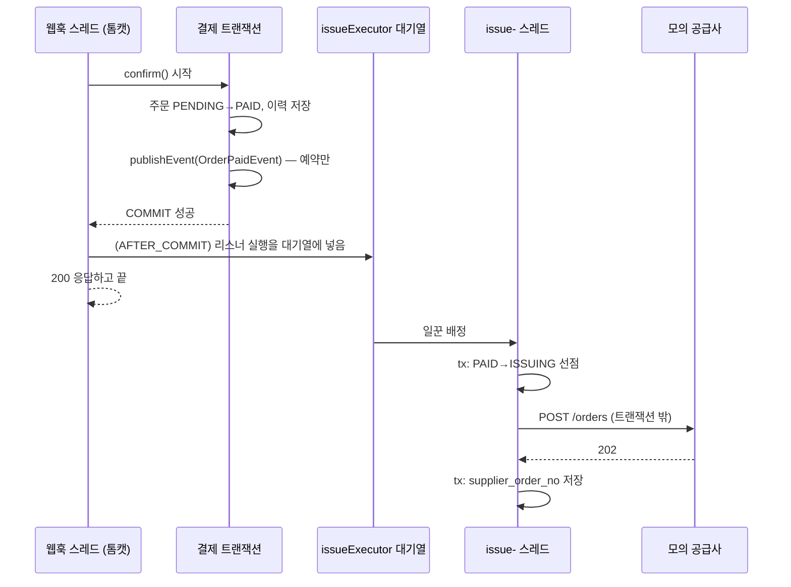

# L2. Spring 비동기·트랜잭션·스케줄러 — 어노테이션별 역할과 동작

> 목표: `@Transactional`, `@Async`, `@TransactionalEventListener`, `@Scheduled`가 **각각 무엇을 하고, 이 과제에서 어떻게 조합되는지**를 내 말로 설명할 수 있게 된다
> 관련 질문: Q1(비동기 작업 방식), Q2(브라우저 닫힘), Q4(트랜잭션 경계)

---

## 0. 한 줄 비유

> - `@Transactional` = **"이 묶음은 전부 되거나 전부 안 되거나"** 계약서
> - `@Async` = **"이건 다른 직원에게 맡기고 나는 다음 일을 한다"**
> - `@TransactionalEventListener(AFTER_COMMIT)` = **"계약서에 도장이 찍힌 뒤에만 알려 줘"**
> - `@Scheduled` = **"30분마다 순찰을 돈다"**

---

## 1. 기초: 동기, 비동기, 스레드, 스레드풀

**스레드(thread)**는 코드를 실행하는 일꾼 한 명이다. 요청 하나가 들어오면 톰캣(Spring의 웹 서버)이 일꾼 한 명을 배정해 컨트롤러부터 끝까지 처리한다.

```
동기(synchronous): 일꾼 A가 결제 저장 → 공급사 호출(3초 대기) → 응답
                   └ 사용자는 3초를 기다림

비동기(asynchronous): 일꾼 A가 결제 저장 → "발급은 일꾼 B에게" → 즉시 응답
                      일꾼 B(별도 스레드)가 공급사 호출(3초)
```

**스레드풀(thread pool)**은 일꾼을 미리 몇 명 고용해 두는 것이다. 매번 새로 뽑으면(스레드 생성) 비싸므로 대기 중인 일꾼에게 일을 맡긴다. 일꾼이 모두 바쁘면 일은 **대기열(queue)**에서 기다린다.

## 2. `@Transactional` — 전부 되거나 전부 안 되거나

### 2.1 하는 일
```java
@Service
public class OrderTxService {
    @Transactional
    public void markPaid(Long orderId) {
        orderRepository.updateStatusIf(orderId, "PENDING", "PAID");  // ①
        historyRepository.save(...);                                   // ②
    }   // 메서드가 정상 종료되면 COMMIT, RuntimeException이 나면 ①② 모두 ROLLBACK
}
```

### 2.2 어떻게 동작하나 — 프록시(대리인)
Spring은 `OrderTxService`를 그대로 쓰지 않고, 앞에 **프록시(대리인) 객체**를 하나 세운다.

```
호출자 → [프록시] begin 트랜잭션 → [진짜 OrderTxService.markPaid()] → [프록시] commit 또는 rollback
```

다른 클래스에서 `orderTxService.markPaid()`를 호출하면 실제로는 프록시를 거치기 때문에 트랜잭션이 걸린다.

### 2.3 자주 하는 실수: 같은 클래스 안에서 호출하면 적용 안 됨
```java
@Service
public class PaymentService {
    public void pay() {
        this.saveReady();          // ❌ this = 진짜 객체 → 프록시를 안 거침 → 트랜잭션 없음!
        pgClient.approve();
    }
    @Transactional
    public void saveReady() { ... }
}
```
**해결 방법 두 가지**
1. 트랜잭션이 필요한 메서드를 **별도 클래스**로 분리하고 주입받아 호출한다. 다른 빈을 거치므로 프록시가 적용된다
2. 프록시 없이 **`TransactionTemplate`**으로 트랜잭션 범위를 코드 블록으로 직접 감싼다
   ```java
   Payment ready = transactionTemplate.execute(status -> paymentRepository.save(...));   // 이 블록만 트랜잭션
   pgClient.approve(...);                                                              // 트랜잭션 밖
   ```

이 과제는 처음에 1번(`PaymentFacade` + `PaymentTxService`)으로 했다가 2번으로 바꿨다. Service 위에 클래스가 하나 더 생겨 기능마다 모양이 달라졌기 때문이다(ADR-15). 다만 승인 응답·웹훅·대사가 함께 쓰는 확정 로직은 다른 빈(`PaymentConfirmService`)의 `@Transactional` 메서드로 두었다(`06` §2).

### 2.4 알아 둘 것
- **롤백 기본 규칙**: `RuntimeException`과 `Error`만 롤백한다. `Exception`(checked)은 기본적으로 **커밋된다** → 필요하면 `@Transactional(rollbackFor = Exception.class)`
- **전파(propagation)**: 기본값 `REQUIRED`는 "이미 트랜잭션이 있으면 거기에 참여하고, 없으면 새로 만든다"는 뜻이다. `REQUIRES_NEW`는 "무조건 새 트랜잭션"이다
- **트랜잭션 안에서 외부 HTTP 호출 금지**(이 과제의 규칙, `06` §1)

## 3. `@Async` — 다른 스레드에서 실행

### 3.1 켜기와 사용
```java
@Configuration
@EnableAsync                       // ① @Async 기능 켜기
public class AsyncConfig {
    @Bean(name = "issueExecutor")  // ② 일꾼 풀 직접 정의 (크기를 명시해서 통제)
    public ThreadPoolTaskExecutor issueExecutor() {
        var ex = new ThreadPoolTaskExecutor();
        ex.setCorePoolSize(4);      // 평소 일꾼 4명
        ex.setMaxPoolSize(8);       // 바쁘면 8명까지 (대기열이 꽉 찬 뒤에)
        ex.setQueueCapacity(100);   // 대기열 100개
        ex.setThreadNamePrefix("issue-");
        ex.initialize();
        return ex;
    }
}

@Service
public class IssueServiceImpl implements IssueService {   // 인터페이스 + 구현 (ADR-18)
    @Async("issueExecutor")         // ③ 이 메서드는 issue- 스레드에서 실행됨
    public void requestIssue(Long orderId) { ... }
}
```

### 3.2 동작
```
호출자 스레드: issueService.requestIssue(1)  → (프록시가 작업을 풀에 넣음) → 즉시 다음 줄로
issue-1 스레드:                                 requestIssue(1) 실제 실행
```

### 3.3 주의점
| 주의 | 설명 |
|---|---|
| **같은 클래스 내부 호출 ❌** | `@Transactional`과 같은 프록시 방식이므로 `this.requestIssue()`는 동기로 실행된다 |
| **예외가 호출자에게 안 돌아옴** | 다른 스레드에서 일어나기 때문이다. 반환 타입이 `void`면 예외가 로그로만 남는다 → 메서드 안에서 try-catch로 실패를 **DB에 기록**한다(`last_error`) |
| **서버가 꺼지면 사라짐** | 대기열은 메모리에 있다. 재시작하면 대기 중이던 작업이 날아간다 → **그래서 스케줄러 안전망이 필요**(§6) |
| **트랜잭션은 이어지지 않음** | 새 스레드는 호출자의 트랜잭션과 무관하다. 필요하면 그 안에서 새로 시작한다 |

## 4. 이벤트: `ApplicationEventPublisher` + `@TransactionalEventListener`

### 4.1 왜 이벤트를 쓰나
결제 확정 코드가 발급 코드를 직접 부르면 결제와 발급이 단단히 묶인다. 이벤트를 쓰면 결제 쪽은 "결제됐다"는 **사실만 알리고**, 누가 그 사실에 반응하는지는 몰라도 된다.

### 4.2 코드
```java
// 이벤트 = 그냥 데이터 클래스
public record OrderPaidEvent(Long orderId) {}

// 발행하는 쪽 (트랜잭션 안)
@Service
public class PaymentConfirmServiceImpl implements PaymentConfirmService {
    private final ApplicationEventPublisher events;

    @Transactional
    public void confirm(...) {
        ...주문 PENDING→PAID...
        events.publishEvent(new OrderPaidEvent(orderId));   // 지금 바로 전달되지 않고 "커밋 후"로 예약됨
    }
}

// 받는 쪽
@Component
public class IssueTrigger {
    @Async("issueExecutor")
    @TransactionalEventListener(phase = TransactionPhase.AFTER_COMMIT)
    public void on(OrderPaidEvent e) {
        issueService.requestIssue(e.orderId());
    }
}
```

### 4.3 phase 종류
| phase | 언제 실행 | 쓰임 |
|---|---|---|
| `AFTER_COMMIT` (기본값) | **커밋이 성공한 뒤** | ✅ 결제가 확정된 뒤에만 발급 |
| `AFTER_ROLLBACK` | 롤백된 뒤 | 실패 알림 |
| `AFTER_COMPLETION` | 커밋이든 롤백이든 끝난 뒤 | 정리 작업 |
| `BEFORE_COMMIT` | 커밋 직전(같은 트랜잭션 안) | 커밋 전 추가 검증 |

### 4.4 왜 `AFTER_COMMIT`인가 — 일반 `@EventListener`와의 차이
```
@EventListener:               publishEvent() 하는 순간 바로 실행
   → 결제 트랜잭션이 아직 커밋 전 → 발급 요청 나감 → 그 뒤 결제가 롤백되면?
   → 돈은 안 받았는데 SIM은 발급됨 ❌

@TransactionalEventListener(AFTER_COMMIT): 결제 커밋 성공 후에만 실행
   → 롤백되면 이벤트 자체가 버려짐 ✅
```

### 4.5 함정 두 가지
1. **트랜잭션 밖에서 발행하면 무시된다.** 실행 중인 트랜잭션이 없으면 `@TransactionalEventListener`는 호출되지 않는다(`fallbackExecution = true`로 바꿀 수 있음). 그래서 발행은 반드시 `@Transactional` 메서드 안에서 한다
2. **AFTER_COMMIT 리스너에서 DB에 쓰면 커밋되지 않을 수 있다.** 이미 커밋이 끝난 트랜잭션의 끝자락에서 실행되기 때문이다. 해결책은 `@Async`로 **다른 스레드**에서 실행하거나(새 트랜잭션이 시작됨), 리스너가 호출하는 메서드에 `@Transactional(propagation = REQUIRES_NEW)`를 붙이는 것이다. 이 과제는 `@Async`를 함께 써서 해결했다

### 4.6 전체 흐름


## 5. `@Scheduled` — 주기적으로 실행

### 5.1 켜기와 사용
```java
@Configuration
@EnableScheduling
@ConditionalOnProperty(name = "app.scheduling.enabled", havingValue = "true", matchIfMissing = true)
public class SchedulingConfig {}     // 테스트에서는 false로 꺼서 테스트가 직접 호출하게 함

@Component
public class IssueRetryScheduler {
    @Scheduled(fixedDelay = 30_000, initialDelay = 10_000)
    public void run() {
        // PAID로 30초 넘게 방치된 주문, ISSUING에서 콜백 2분 넘게 없는 주문을 다시 요청
        for (Long id : orderRepository.findStuckForIssue(clock.instant(), 50)) {
            issueService.requestIssueSync(id);   // 내부에서 상태 선점 → 중복 실행돼도 안전
        }
    }
}
```

### 5.2 주기 옵션
| 옵션 | 의미 | 예 |
|---|---|---|
| `fixedDelay = 30000` | **이전 실행이 끝난 뒤** 30초 후 다시 | ✅ 이 과제. 작업이 길어져도 겹치지 않음 |
| `fixedRate = 30000` | **이전 실행 시작 기준** 30초마다 | 작업이 30초보다 길면 밀림 |
| `cron = "0 0 * * * *"` | 정해진 시각(매시 정각) | 만료 처리 |
| `initialDelay` | 서버 시작 후 첫 실행까지 대기 | 시작 직후 부하 분산 |

### 5.3 주의점
- **스케줄러 스레드는 기본 1개다.** 한 작업이 오래 걸리면 다른 스케줄 작업이 전부 밀린다 → `spring.task.scheduling.pool.size=3`처럼 늘린다
- **서버가 꺼져 있으면 실행되지 않는다.** 그래서 "할 일"을 메모리가 아니라 **DB 상태로** 남긴다. 서버가 다시 켜지면 첫 실행에서 밀린 일을 처리한다
- **서버가 2대면 둘 다 실행된다.** 이 과제는 1대를 가정하고, 2대 이상이면 ShedLock(DB 테이블로 "지금 내가 실행 중" 락) 또는 `SELECT ... FOR UPDATE SKIP LOCKED`(다른 서버가 잡은 행은 건너뛰기)가 필요하다. 다만 조건부 UPDATE로 상태를 선점하므로 **결과가 두 번 반영되지는 않는다**

## 6. 왜 `@Async` + `@Scheduled`를 둘 다 쓰나

| | `@Async`(이벤트)만 | `@Scheduled`만 | **둘 다 (채택)** |
|---|---|---|---|
| 속도 | 즉시 | 최대 30초 지연 | 즉시 |
| 서버 재시작 시 | 대기 중 작업 유실 | DB에서 다시 찾음 | 유실돼도 스케줄러가 주움 |
| 콜백이 안 오면 | 아무도 모름 | 재시도 | 재시도 |

**핵심 문장**: "**진짜 할 일 목록은 DB의 주문 상태다.** `@Async`는 그 일을 빨리 시작하는 지름길이고, `@Scheduled`는 지름길에서 놓친 일을 줍는 안전망이다."

## 7. 이 과제의 비동기 작업 전체 목록

| 작업 | 트리거 | 주기 | 대상 선별 조건 | 종료 조건 / 상한 |
|---|---|---|---|---|
| 발급 요청 | `OrderPaidEvent` (AFTER_COMMIT + @Async) | 즉시 | 방금 PAID가 된 주문 | 공급사 202 수신 |
| 발급 재시도 | `IssueRetryScheduler` | 30초 | `PAID` 30초 초과 / `ISSUING` 콜백 2분 초과 | 3회 초과 → ISSUE_FAILED → 환불 |
| 결제 만료 | `OrderExpireScheduler` | 1분 | `PENDING` & `expires_at < now` (진행 중 결제는 2분 유예) | EXPIRED |
| 결제 대사 | `PaymentReconcileScheduler` | 1분 | `payment.READY` 1분 초과 | PG 조회로 확정, 15분 초과 시 이상 건 |
| 환불 처리 | `RefundService.start()` 직후 @Async + `RefundRetryScheduler` | 30초 | `refund_attempt` PENDING & `next_retry_at <= now` | 3회 → REFUND_FAILED |
| 설치 폴링 | `InstallPollingScheduler` | 1분 | `next_poll_at <= now` 최대 100개 | 종료 상태는 대상 아님 |
| 사용 만료 | `ProfileExpireScheduler` | 1시간 | `ACTIVE` & `expires_at < now` | EXPIRED |
| 콜백·웹훅 처리 | 컨트롤러 (동기) | 요청 시 | - | 커밋 후 200 응답 |

## 8. 왜 메시지 큐(Kafka 등)를 쓰지 않았나

- 큐는 "작업을 안전하게 쌓아 두고 여러 소비자가 나눠 처리"하는 데 강하다
- 그러나 브로커를 하나 더 운영해야 한다. 무료 EC2 1GB 메모리에 Kafka는 현실적이지 않다
- 이 과제의 트래픽에서는 **DB 상태 + 스케줄러**가 큐 역할을 충분히 한다
- 바꿔야 하는 시점: 서버가 여러 대가 되고, 작업량이 스케줄러 한 대로 감당되지 않을 때(`07` §5)

## 9. 면접에서 말하는 법

> "결제가 확정되면 트랜잭션이 커밋된 뒤에 이벤트를 받아서 `@Async`로 별도 스레드에서 발급을 요청합니다. `AFTER_COMMIT`을 쓴 이유는 결제가 롤백됐는데 발급이 나가는 걸 막기 위해서입니다.
> 다만 `@Async` 작업은 메모리에만 있어서 서버가 그 순간 죽으면 사라집니다. 그래서 30초마다 도는 스케줄러가 DB에서 'PAID인데 발급 요청이 안 된 주문'을 찾아 다시 요청하게 했습니다. 스케줄러가 같은 주문을 다시 집어도 상태를 조건부 UPDATE로 선점하기 때문에 두 번 발급되지는 않습니다."

### 스스로 점검
- [ ] 같은 클래스 안에서 `@Transactional` 메서드를 부르면 왜 적용이 안 되는지 "프록시"라는 단어로 설명할 수 있다
- [ ] `@EventListener` 대신 `@TransactionalEventListener(AFTER_COMMIT)`를 쓴 이유를 말할 수 있다
- [ ] `@Async` 작업이 사라지는 상황과 그것을 무엇이 메우는지 말할 수 있다
- [ ] `fixedDelay`와 `fixedRate`의 차이를 말할 수 있다
- [ ] 서버가 2대가 되면 무엇이 문제가 되고 무엇이 문제가 되지 않는지 말할 수 있다
